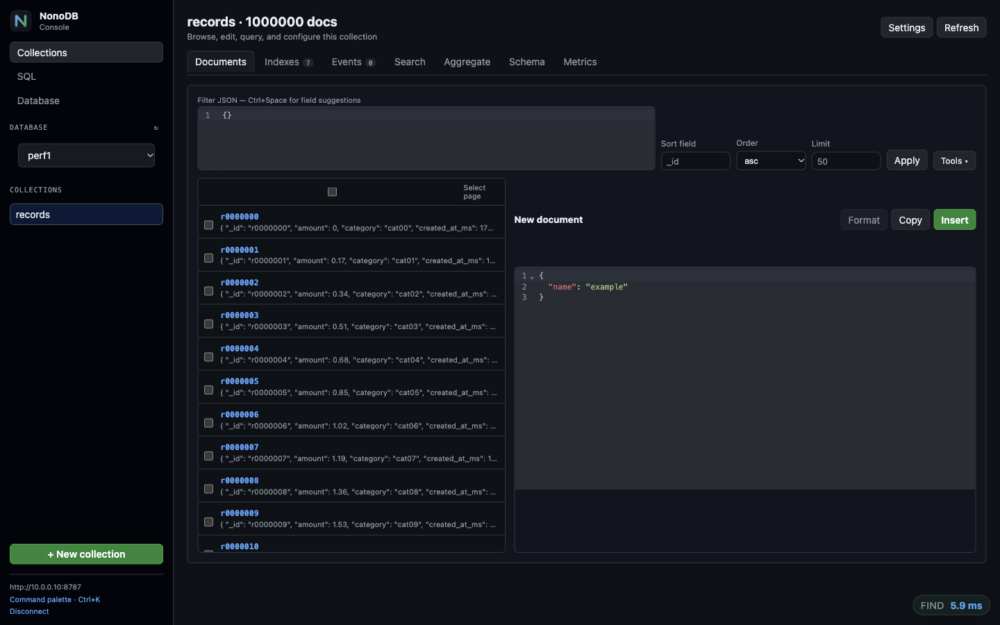
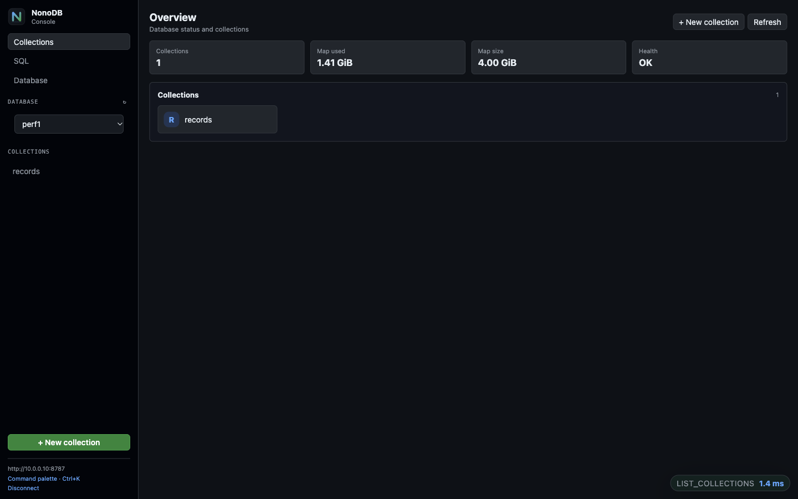
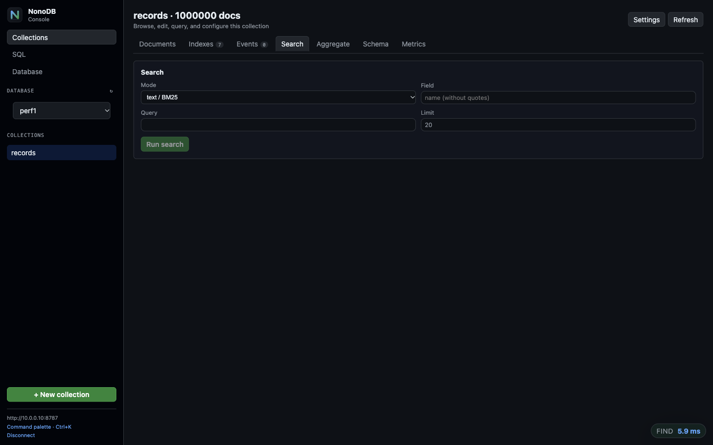

<p align="center">
  
</p>

# NoNoDB

[](https://github.com/essmos/nonodb/actions/workflows/ci.yml)
[](https://github.com/essmos/nonodb/actions/workflows/release.yml)

**A low-resource, crash-safe JSON document database — with a surprisingly
large feature set under the hood.**

**Idle daemon memory: about 5 MB RAM.** That is measured with a 1M-document
database and three indexes after a restart. The on-disk LMDB file grows with
the data and indexes; the ~5 MB figure is process memory, not the database
files. Hot data stays in the OS page cache instead of the daemon heap.

NoNoDB is a local NoSQL document store written in Rust. It needs no external
database server and runs comfortably on small VMs, edge boxes, and developer
machines. It speaks a practical subset of MongoDB's query language over
HTTP/JSON, stores documents in LMDB, and runs as a single daemon that is the
only process allowed to touch the database files. Application workers connect
to it through a Unix socket and use a thin client. One daemon can host several
independent databases.

<p align="center">
  <a href="docs/gui.md">
    
  </a>
</p>

<p align="center"><em>The embedded GUI browsing a 1,000,000-document database.
<a href="docs/gui.md">See the GUI guide</a>.</em></p>

Low resource use is the starting point, not the whole story. Under the hood,
nonodb is a real document database with:

- JSON documents, MongoDB-style filters, projections, sorting and updates;
- BSON-compatible dates with RFC 3339 input, timezone normalization and indexed ranges;
- exact numeric comparison, BSON Decimal128, binary/UUID and ObjectId values with indexed ranges;
- single-field, compound, unique and covering secondary indexes;
- atomic `write_batch` for all-or-nothing groups of writes;
- full-text search with **BM25** ranking, Unicode tokenization, diacritic
  folding and quoted phrases;
- fuzzy search using trigrams plus Levenshtein distance;
- exact vector search with cosine, dot, and L2 metrics, stored and queried
  inside the same LMDB file;
- a read-only aggregation pipeline for reporting and summaries;
- snapshots, online backup, online LMDB map growth, authentication, TLS/mTLS, metrics and a CLI;
- graceful shutdown with in-flight request draining and optional JSON logs;
- per-collection document revision history with global revision IDs and configurable retention (`0` disables);
- document TTL with collection defaults, per-document overrides, and background expiry;
- optional vault collections with whole-document encryption and per-tenant keys;
- a bounded daemon read cache, invalidated after every committed write;
- optional automatic indexes for frequent query shapes, with TTL cleanup;
- single-field GeoJSON point indexes for `$near` and `$geoWithin`.

**Forget about creating indexes — NoNoDB will do it for you if it decides it is
necessary.** Automatic indexing is opt-in (`NONODB_AUTO_INDEX=1`), conservative,
and removes unused automatic indexes after a configurable TTL.

These are capabilities often split across several services or reserved for
larger databases and paid enterprise editions. nonodb puts them in one small,
MIT-licensed binary: no paid tier, no license keys, no feature gates.

If you need a shared, queryable JSON store without operating PostgreSQL,
MongoDB, or Redis, nonodb is aimed at you.

```text
┌──────────────────┐
│ uvicorn worker 1 │──┐
│ uvicorn worker 2 │──┤   HTTP/JSON over Unix socket   ┌───────────────┐
│ ...              │──┼───────────────────────────────▶│ nonodb-daemon │
│ uvicorn worker N │──┘                                │ 1 writer / DB │
└──────────────────┘                                   │ N LMDB envs   │
                                                       └───────┬───────┘
                                                               │
                                                   ./data/<database>/ (LMDB)
```

## Why nonodb exists

Web applications accumulate small pieces of shared state: feature flags,
tenant settings, notification templates, routing rules, counters, cached
metadata, user preferences, and other JSON-shaped records. At first these live
in YAML files or environment variables. Sooner or later several processes need
to read and update them concurrently, query them by more than one field, and
survive a crash.

The usual answers are heavier than the problem:

- **PostgreSQL / MySQL** require a server, a schema, migrations, connection
  pooling, and operational work for what is often a handful of collections.
- **MongoDB** is a full distributed database with its own deployment and
  security surface.
- **Redis** is excellent for keys and counters, but it is not a document store
  with secondary indexes, rich filters, or durable snapshots by default.
- **Files on disk** are easy to start with and painful to keep consistent:
  partial writes, no concurrent update semantics, no indexes, no atomic batch.
- **An embedded database inside every worker** looks attractive, but LMDB and
  many embedded engines are sensitive to `fork()`, multiple owners, and stale
  readers. With preforking servers such as Gunicorn or uvicorn, every worker
  would otherwise open the same environment independently.

nonodb takes the SQLite philosophy — embedded, zero-administration, one local
data directory — and applies it to JSON documents. It separates the database
engine from its clients:

1. **One daemon owns every LMDB environment.** No other process opens the data
   files. This removes multi-process mmap, `fork()`, and stale-reader problems.
   Databases are isolated from each other while sharing one daemon and port.
2. **Clients are thin.** Application workers talk HTTP/JSON over a Unix socket.
   A Python client wraps this in a small, familiar API.
3. **Writes are serialized and grouped.** One writer thread batches requests and
   performs one `fsync` per group, while reads are concurrent MVCC snapshots.
4. **Query semantics are familiar.** Filters, projections, sorts, secondary
   indexes, update operators, and upserts follow MongoDB conventions where it
   makes sense.
5. **The storage engine is boring on purpose.** LMDB is copy-on-write,
   memory-mapped, and crash-safe. A `kill -9` does not corrupt the database.

The result is a small service that feels like an embedded database to the
application, but behaves like a shared database to a preforking web server.

## What nonodb is not

nonodb is deliberately not a general-purpose distributed database. It has:

- no sharding, replication, or clustering;
- no general interactive multi-document transactions;
- no MongoDB wire-protocol compatibility;
- no cross-collection joins (`$lookup`) or write stages (`$merge`/`$out`);
- no users, roles, or inherited groups beyond per-collection scopes;
- a practical subset of MongoDB query and update operators.

For a single host, a small-to-medium data set, and a workload dominated by
indexed reads and modest writes, those trade-offs buy a very small operational
footprint.

## Multiple databases

One daemon can host several independent databases under `NONODB_DATA`:
`default`, `app1`, and so on. Use `/<database>/v1/exec` (or `/v1/exec` for
`default`), `nonodb-cli --db <name>`, or the GUI database selector. Legacy
single-database directories are migrated to `default/` on startup. See
[Multiple databases](docs/multi-database.md).

## Features

### Documents and queries

- JSON documents in named collections, stored as JSON on disk.
- Automatic `_id` generation with UUID v4; custom string `_id` is supported.
- MongoDB-style filters: equality, `$eq`, `$ne`, `$gt`, `$gte`, `$lt`, `$lte`,
  `$in`, `$nin`, `$all`, `$size`, `$elemMatch`, `$exists`, `$regex`/`$options`,
  `$type`, `$not`, `$and`, `$or`, `$nor`.
- Nested paths (`{"user.address.city": "..."}`), array membership, and
  consistent, exact numeric comparison (`30 == 30.0`; large integers stay
  distinct).
- Projection, multi-field sort, `skip`, and `limit`.
- Fast `find_one`/`find` paths that stop after enough matches, a raw JSON
  prefilter for simple string/boolean equalities, and `count({})`
  in O(1).
- Ordered `lookup` for up to 10,000 keys by `_id` or a unique single-field or
  compound index, with covering projections, `_id` exclusion, internal key
  deduplication, a 64 MiB response cap, and `null` for missing keys.
- SQL `SELECT`, `INSERT`, `UPDATE`, and `DELETE` over one collection. `SELECT`
  supports `DISTINCT`, `WHERE`, `GROUP BY`, `HAVING`, aggregates including
  `COUNT(DISTINCT field)`, `CASE`, scalar functions, `ORDER BY`,
  `LIMIT`/`OFFSET`, positional parameters, and `explain_sql`; simple field-only
  queries use the normal indexed `find` path. Writes use the single writer and
  are atomic per statement, including document expressions in `UPDATE SET`;
  there are no joins.

### Writes and updates

- `insert`, `insert_many`, `update`, `delete`, with optional `multi`.
- Update operators: `$set`, `$unset`, `$inc`, `$push`, `$pull`, `$addToSet`,
  `$setOnInsert`.
- `$each` for `$push` and `$addToSet`.
- Upsert with filter equality seeding, replacement upserts, and
  `$setOnInsert`.
- Atomic `find_and_modify`: select with sort, update or remove, and return the
  old or new document in one transaction.
- `explain`: selected access path, index/range bounds, sort coverage, and
  actual matched/returned counts.
- Replacement updates preserve `_id`.
- Atomic `write_batch`: all operations commit or the whole batch rolls back.
- Read-only `batch`: many reads in one LMDB snapshot and one HTTP round trip.
- `find_cursor` / `aggregate_cursor`: bounded `_id` keyset pagination with
  `get_more` and `close_cursor` for large result sets.

### Indexes

- Single-field and compound secondary indexes.
- Multikey indexes: arrays produce one entry per element, including nested
  paths such as `items.price`; compound indexes reject parallel arrays.
- Batch index creation scans the collection once and builds several indexes in
  one transaction.
- Unique indexes, enforced on insert, update, and index backfill. A unique
  multikey index allows duplicate elements inside one document but not across
  documents.
- Order-preserving key encoding for ranges.
- Index-only sorted scans when a sort matches the full index order, including
  sort-only queries with no filter. Multikey sorts use the lowest array element
  ascending and the highest descending.
- Top-level `$or` index union across indexed fields, `$type` index ranges,
  indexed `$all`, and `$elemMatch` on dotted array paths.
- Covering indexes with `include`, serving projections without fetching the
  document.
- Index-backed `count` when the filter exactly matches the indexed fields.
- Single-field GeoJSON point indexes with `$near`, `$geoWithin`, and
  `$geoIntersects`; queries use hierarchical grid ranges plus exact residual
  checks.
- Parallel index backfill for existing collections.

### Search

- Full-text search with an inverted index and BM25 ranking (`_score`).
- Unicode-aware tokenization, lowercase, and diacritic folding
  (`zażółć` → `zazolc`).
- Quoted phrases requiring contiguous token sequences.
- Fuzzy search with trigrams plus bounded Levenshtein distance (`_distance`).
- Exact vector search with `cosine`, `dot`, and `l2` metrics. Vectors are
  stored in LMDB and queried with a brute-force top-K scan; no external vector
  service is required. Results include `_distance`, lowest first.
- All search indexes are maintained in the same transaction as the document.

### Aggregation

- Read-only `aggregate` endpoint for reporting, grouping, and summaries.
- Stages: `$match`, `$project`, `$addFields`/`$set`, `$unset`, `$unwind`,
  `$group`, `$sort`, `$skip`, `$limit`, and `$count`.
- Accumulators: `$sum`, `$avg`, `$min`, `$max`, `$first`, `$last`, `$push`,
  `$addToSet`, and `$count`.
- Consecutive leading `$match` stages are fused, and a terminal `$count` skips
  cardinality-preserving stages and unnecessary document materialization.
- Document-local stages are fused into one pass, `$sort`+`$limit` uses a
  bounded top-K heap, and a leading `$group` streams documents directly into
  its accumulators. Order-independent groups use the query index when
  available and fall back to a parallel scan.
- A leading `$match` uses the normal query planner, including secondary indexes
  and `_id` ranges. `$sort`+`$limit`, `$skip`, `$limit`, simple `$project`, and
  a lone `$count` are also pushed into the query path where semantics allow.
- Expressions support field references (`"$field"`), `$$ROOT`, `$literal`,
  `$ifNull`, arithmetic, `$concat`, `$cond`, and comparison operators.

```bash
curl -s --unix-socket /tmp/nonodb.sock \
  -H 'content-type: application/json' \
  -X POST http://localhost/v1/exec \
  -d '{"op":"aggregate","coll":"orders","pipeline":[
        {"$match":{"status":"paid"}},
        {"$group":{"_id":"$tenant","total":{"$sum":"$amount"},"n":{"$sum":1}}},
        {"$sort":{"total":-1}},
        {"$limit":10}
      ]}'
```

Aggregation is intentionally bounded: an intermediate result may contain at
most 100,000 documents. It never writes to the database and is available inside
the read-only `batch` operation. See
[Aggregation](docs/api.md#aggregation) for the full stage list and semantics,
and [benchmarks](docs/benchmarks.md#aggregation-pipeline) for stage timings and
optimization notes.

### Document history

- Per-collection append-only revision history for inserts, updates, and deletes.
- History is enabled at collection level with one setting: the number of
  revisions to retain per document. `0` disables new history writes.
- Global monotonic revision IDs; no per-document counter lookup on writes.
- Current documents and indexes are unaffected: search always returns current
  results.
- Revisions are written in the same LMDB transaction as the current document.
- Read revisions with the `history` and `get_version` API operations, or the
  `history`/`get_version` helpers in the official clients.

Enable it for one collection:

```bash
nonodb-cli history users 50
```

or with the API:

```json
{"op":"set_collection_history","coll":"users","max_versions":50}
```

Then inspect a document:

```bash
curl -s --unix-socket /tmp/nonodb.sock \
  -H 'content-type: application/json' \
  -X POST http://localhost/v1/exec \
  -d '{"op":"history","coll":"users","id":"<id>","include_docs":true}'

curl -s --unix-socket /tmp/nonodb.sock \
  -H 'content-type: application/json' \
  -X POST http://localhost/v1/exec \
  -d '{"op":"get_version","coll":"users","id":"<id>","version":1042}'
```

See [Document history](docs/api.md#document-history) for the full request and
retention semantics.

### Dates

- Dates are BSON-compatible instants stored as UTC Unix milliseconds.
- Accepts relaxed Extended JSON (`{"$date": "2026-01-01T00:00:00Z"}`),
  canonical `$numberLong`, and numeric milliseconds.
- RFC 3339 offsets are normalized, so different offsets for the same instant
  compare equal.
- Standard `$eq`, `$gte`, `$lt`, `$in`, sorting, and secondary indexes work on
  dates; no special date operators are needed.
- Naive local datetimes are rejected as ambiguous.

```bash
curl -s --unix-socket /tmp/nonodb.sock \
  -H 'content-type: application/json' \
  -X POST http://localhost/v1/exec \
  -d '{"op":"insert","coll":"events","doc":{"_id":"e1","at":{"$date":"2026-01-01T01:00:00+01:00"}}}'
```

See [Dates and time zones](docs/dates.md) for formats, indexes, and limitations.


### Numbers and decimals

- JSON integers, floats, Decimal128, and `NaN`/`Infinity` share one numeric
  type bracket.
- Integers compare and index exactly; values above `2^53` are not collapsed
  through `f64`.
- Decimals use Extended JSON: `{"$numberDecimal": "199.9900"}`.
- Decimal arithmetic is available in `$inc`, `$sum`, `$avg`, `$add`,
  `$subtract`, `$multiply`, and `$divide`.
- Special IEEE-754 values use `{"$numberDouble": "NaN"}` or
  `{"$numberDouble": "Infinity"}`.
- Integer forms `{"$numberInt": "42"}` / `{"$numberLong": "9007199254740993"}`
  preserve their BSON type.
- Binary/UUID (`$binary`, `$uuid`) and ObjectId (`$oid`) values are indexed.
- The `$type` query operator matches BSON scalar types by name or code.
- Long text remains a normal string, bounded by the 1 MiB document limit.

See [Numbers and decimals](docs/numerics.md) for storage forms, arithmetic,
index compatibility, and limits.

### Document TTL

- Optional collection default (`ttl_seconds`) and per-document `_ttl` override.
- Expiry metadata is stored outside the document; `_ttl` is not returned by
  reads.
- Updates preserve the current TTL unless `_ttl` is explicitly set.
- Background maintenance sweeps due documents through the single writer.
- TTL deletes remove index entries and append a history tombstone when history
  is enabled; collections can opt into purging stored revisions instead.
- Works for standard and vault collections.

```bash
curl -s --unix-socket /tmp/nonodb.sock \
  -H 'content-type: application/json' \
  -X POST http://localhost/v1/exec \
  -d '{"op":"create_collection","coll":"sessions","ttl_seconds":86400}'

curl -s --unix-socket /tmp/nonodb.sock \
  -H 'content-type: application/json' \
  -X POST http://localhost/v1/exec \
  -d '{"op":"insert","coll":"sessions","doc":{"_id":"s1","user":7,"_ttl":300}}'
```

TTL is eventual: a document can be visible briefly after its expiry. See
[Document TTL](docs/ttl.md) for update semantics, maintenance, and limits.

### Vault collections (optional encryption)

- Opt-in `profile: "vault"` collection; standard collections are unchanged.
- Whole-document XChaCha20-Poly1305 encryption; only `_id` and `tenant_id` remain
  plaintext.
- Per-request tenant key in headers: `X-NonoDB-Tenant`,
  `X-NonoDB-Key-Id`, `X-NonoDB-Key`.
- AAD binds ciphertext to collection, tenant, `_id`, and key id.
- Restricted API: CRUD by `_id`, list/count by `tenant_id`, history; no search,
  fuzzy, aggregation, secondary indexes, arbitrary filters, or sorting.
- History stores ciphertext and decrypts snapshots only for an authenticated
  key.
- Cache and automatic indexes are disabled for vault collections.

Create and use a vault collection:

```bash
KEY=$(python3 -c 'import base64, os; print(base64.b64encode(os.urandom(32)).decode())')

curl -s --unix-socket /tmp/nonodb.sock \
  -H 'content-type: application/json' \
  -d '{"op":"create_collection","coll":"vault","profile":"vault"}' \
  http://localhost/v1/exec

curl -s --unix-socket /tmp/nonodb.sock \
  -H 'content-type: application/json' \
  -H 'X-NonoDB-Tenant: acme' \
  -H 'X-NonoDB-Key-Id: acme:v1' \
  -H "X-NonoDB-Key: $KEY" \
  -d '{"op":"insert","coll":"vault","doc":{"tenant_id":"acme","notes":"secret"}}' \
  http://localhost/v1/exec
```

This is daemon-side encryption, not end-to-end encryption: the daemon sees
plaintext and the raw key in memory. Use it for encryption at rest when you can
accept the loss of query features. See
[Vault collections](docs/vault.md) for the full contract, limitations, key
rotation, and best-fit guidance.

### Operations

- Single daemon; Unix socket by default, optional TCP.
- File-based principals, per-collection scopes, hashed bearer tokens, Unix
  peer uid/gid allow-lists, and configurable per-IP failed-login lockout.
- Optional TLS for TCP using rustls, including mutual TLS mapped to authorization
  principals.
- Append-only JSONL audit log with optional read auditing and fsync.
- Periodic LMDB snapshots with retention.
- Online backup with SHA-256 manifests, deep verification, restore drills, and inspection.
- JSON metrics endpoint and request/queue/commit counters.
- Graceful `SIGTERM`/`SIGINT` drain: stop accepting, finish in-flight requests,
  flush the writer queue, and remove the Unix socket.
- Text or JSON logs with per-request method, path, status, and duration.
- Group commit with adaptive batching, request size limits, and request
  timeouts.
- Official thin clients for Python, Rust, Node.js, and Go.
- Background jobs through a normal `_jobs` collection and outbox events through
  `_events`, both handled by external workers; no stored procedures or daemon
  plugins.
- Per-collection automatic `insert`/`update`/`delete` change events, with
  optional field-change filtering and atomic outbox writes.
- Persistent conditional subscriptions with document and count conditions,
  client-renewed leases, and writer-side evaluation; delivered through the same
  outbox.
- Long-poll `watch` and continuous NDJSON/SSE `/v1/watch` streams for append-only
  outbox events, with server-side topics/filters, projections, count thresholds,
  resume tokens, truncation detection, heartbeats, and reconnect helpers.
- Connection-scoped live subscriptions in `mode:"live"`: conditions are evaluated
  by the writer and pushed directly to the stream without writing to `_events`.
- Docker image, systemd units, crash tests, and end-to-end test scripts.

## Quick start

### Prebuilt binaries

Every tagged release contains ready-to-run binaries. For normal use, download
the archive for your platform instead of compiling:

| Platform | Release asset |
| --- | --- |
| Linux x86_64 | `nonodb-vX.Y.Z-linux-x86_64.tar.gz` |
| macOS Apple Silicon | `nonodb-vX.Y.Z-macos-arm64.tar.gz` |
| macOS Intel | `nonodb-vX.Y.Z-macos-x86_64.tar.gz` |
| Windows x86_64 | `nonodb-vX.Y.Z-windows-x86_64.zip` |

Each archive contains `nonodb-daemon`, `nonodb-cli`, `README.md`, `LICENSE` and
`docs/`. Every archive also has a `.sha256` checksum on the
[releases page](https://github.com/essmos/nonodb/releases).

Linux and macOS use the Unix socket by default. Windows has no Unix socket
listener, so the Windows daemon requires TCP plus `NONODB_AUTH_FILE`.

### Run on Linux

Download, verify, and extract the x86_64 archive:

```bash
TAG=v0.21.0
curl -LO "https://github.com/essmos/nonodb/releases/download/$TAG/nonodb-$TAG-linux-x86_64.tar.gz"
curl -LO "https://github.com/essmos/nonodb/releases/download/$TAG/nonodb-$TAG-linux-x86_64.tar.gz.sha256"
sha256sum -c "nonodb-$TAG-linux-x86_64.tar.gz.sha256"
tar -xzf "nonodb-$TAG-linux-x86_64.tar.gz"
cd "nonodb-$TAG-linux-x86_64"
```

Create the data and socket directories and start the daemon in the foreground:

```bash
mkdir -p /tmp/nonodb-data /tmp/nonodb-run

NONODB_DATA=/tmp/nonodb-data \
NONODB_SOCK=/tmp/nonodb-run/nonodb.sock \
RUST_LOG=info \
./nonodb-daemon
```

Leave that terminal running. In a second terminal, verify the daemon:

```bash
export NONODB_SOCK=/tmp/nonodb-run/nonodb.sock
./nonodb-cli ping
```

Insert and query with `curl`:

```bash
curl -s --unix-socket "$NONODB_SOCK" -H 'content-type: application/json' \
  -X POST http://localhost/v1/exec \
  -d '{"op":"insert","coll":"users","doc":{"name":"Ada","age":36}}'

curl -s --unix-socket "$NONODB_SOCK" -H 'content-type: application/json' \
  -X POST http://localhost/v1/exec \
  -d '{"op":"find","coll":"users","filter":{"age":{"$gte":18}},"sort":[["age",-1]]}'
```

Use the optional Python client. It is not included in the binary archive, so
clone the repository once and point `PYTHONPATH` at its `client` directory:

```bash
git clone --depth 1 https://github.com/essmos/nonodb.git
export PYTHONPATH="$PWD/nonodb/client"
python3 - <<'PY'
from nonodb import NonoDB

with NonoDB("/tmp/nonodb-run/nonodb.sock") as db:
    users = db.collection("users")
    users.insert({"name": "Grace", "age": 41})
    print(users.find({"age": {"$gte": 18}}, sort=[("age", -1)]))
PY
```

Use the CLI:

```bash
NONODB_SOCK=/tmp/nonodb-run/nonodb.sock ./nonodb-cli count users '{}'
NONODB_SOCK=/tmp/nonodb-run/nonodb.sock ./nonodb-cli find users '{}' --sort age:desc --limit 5
```

This runs in the foreground. For a production Linux service, use the systemd
unit and installation steps in [Operations](docs/operations.md#deployment-with-systemd).

### Run on macOS

Download the archive matching your CPU (`uname -m` prints `arm64` or `x86_64`):

```bash
TAG=v0.21.0
ARCHIVE="nonodb-$TAG-macos-arm64.tar.gz"   # use macos-x86_64 on Intel
curl -LO "https://github.com/essmos/nonodb/releases/download/$TAG/$ARCHIVE"
curl -LO "https://github.com/essmos/nonodb/releases/download/$TAG/$ARCHIVE.sha256"
shasum -a 256 -c "$ARCHIVE.sha256"
tar -xzf "$ARCHIVE"
cd "${ARCHIVE%.tar.gz}"
```

Release binaries are not signed or notarized. If Gatekeeper blocks them, remove
the quarantine attribute once:

```bash
xattr -d com.apple.quarantine nonodb-daemon nonodb-cli 2>/dev/null || true
```

Start the daemon exactly as on Linux (Unix socket and `SO_PEERCRED` work on
macOS):

```bash
mkdir -p /tmp/nonodb-data /tmp/nonodb-run

NONODB_DATA=/tmp/nonodb-data \
NONODB_SOCK=/tmp/nonodb-run/nonodb.sock \
RUST_LOG=info \
./nonodb-daemon
```

Then use `nonodb-cli`, `curl --unix-socket`, or the Python client with
`NONODB_SOCK=/tmp/nonodb-run/nonodb.sock`.

### Run on Windows (TCP only)

Download and extract `nonodb-vX.Y.Z-windows-x86_64.zip`, create an auth
registry, then start the daemon from PowerShell. TCP is mandatory on Windows
and always requires `NONODB_AUTH_FILE`:

```powershell
$env:NONODB_DATA = "$PWD\data"
$env:NONODB_TCP = "127.0.0.1:7878"
$env:NONODB_AUTH_FILE = "$PWD\auth.json"
.\nonodb-cli.exe auth init
$TOKEN = .\nonodb-cli.exe auth token create admin
$env:RUST_LOG = "info"
.\nonodb-daemon.exe
```

In a second PowerShell window:

```powershell
$env:NONODB_URL = "http://127.0.0.1:7878"
$env:NONODB_TOKEN = "<token printed by auth token create>"
.\nonodb-cli.exe ping
```

The Windows CLI uses plaintext HTTP over TCP. For TLS or mTLS connections, use
one of the official clients (`NONODB_URL=https://...`, `NONODB_TLS_CA`,
`NONODB_TLS_CLIENT_CERT`, `NONODB_TLS_CLIENT_KEY`). Keep the listener on
`127.0.0.1` unless you terminate TLS in front of it.

### Build from source (alternative)

Use this for development or when no prebuilt archive fits your platform.

Requirements:

- Rust stable (2021 edition; latest stable recommended), Cargo, and a C
  compiler for LMDB.
- Linux or macOS for the Unix-socket daemon. The Windows daemon is TCP-only.
- Python 3.9+ only if you want the optional Python client (`httpx`; `orjson`
  is an optional speedup).

Build the release binaries:

```bash
cargo build --release
```

The binaries are:

```text
target/release/nonodb-daemon
target/release/nonodb-cli
```

Use the same commands as above, replacing `./nonodb-daemon` with
`./target/release/nonodb-daemon` and `./nonodb-cli` with
`./target/release/nonodb-cli`.

### Run with Docker

The Docker workflow publishes versioned images to GitHub Container Registry for
Linux `amd64` and `arm64`. Pull a published tag:

```bash
docker pull ghcr.io/essmos/nonodb:0.21.0
```

Pin a version in production. The `latest` tag follows stable releases. If the
package is private, authenticate first:

```bash
echo "$GHCR_TOKEN" | docker login ghcr.io -u YOUR_GITHUB_USER --password-stdin
```

The simplest way to use it from a process on the host is TCP on loopback with
an auth registry mounted read-only:

```bash
export NONODB_AUTH_FILE="$PWD/nonodb-auth.json"
nonodb-cli auth init
export TOKEN=$(nonodb-cli auth token create admin)

docker volume create nonodb-data
docker run -d --name nonodb \
  -e NONODB_AUTH_FILE=/etc/nonodb/auth.json \
  -e NONODB_TCP=0.0.0.0:7878 \
  -p 127.0.0.1:7878:7878 \
  --group-add "$(id -g)" \
  -v "$NONODB_AUTH_FILE:/etc/nonodb/auth.json:ro" \
  -v nonodb-data:/var/lib/nonodb \
  ghcr.io/essmos/nonodb:0.21.0
```

Check health and logs:

```bash
curl -s http://127.0.0.1:7878/healthz
docker logs nonodb
```

Connect from Python:

```python
from nonodb import NonoDB

db = NonoDB(
    base_url="http://127.0.0.1:7878",
    token=os.environ["TOKEN"],
)
print(db.collection("users").count())
db.close()
```

The named volume `nonodb-data` persists `/var/lib/nonodb`. The container runs as
the unprivileged `nonodb` user.

For container-to-container access over a Unix socket, mount a shared volume at
`/run/nonodb`, for example `-v nonodb-run:/run/nonodb`. The client container must
be able to access the socket with a matching uid/gid. For host processes, TCP on
`127.0.0.1` is usually simpler; add TLS if the listener is not loopback-only.

Docker Compose example:

```bash
export NONODB_AUTH_FILE="$PWD/nonodb-auth.json"
nonodb-cli auth init
nonodb-cli auth token create admin
docker compose -f deploy/docker-compose.yml up -d
```

Set `NONODB_IMAGE` to pin another image tag. To build the image from source
instead, use `docker build -t nonodb:local .` and set
`NONODB_IMAGE=nonodb:local`.

More deployment details: [Operations — Docker](docs/operations.md#docker).

## GUI console

`nonodb-cli` ships with an embedded local web console:

```bash
nonodb-cli gui
```

It opens `http://127.0.0.1:8787`, serves the embedded React application, and
proxies API calls to the daemon over the local socket. For Docker, enable the
optional GUI profile:

```bash
docker compose -f deploy/docker-compose.yml --profile gui up -d
```

The GUI supports document browsing and editing, collection settings,
TTL/history/events, secondary indexes, SQL, LMDB map settings, and metrics.
Node.js is only needed to build the GUI, not to run it.

<p align="center">
  
  
</p>

The screenshots use the `perf1` database with one million documents and the
database selector introduced by the multi-database implementation. More views
and a short walkthrough video are in the [GUI console](docs/gui.md#screenshots)
documentation.

[Watch the 16-second GUI walkthrough](docs/assets/gui/demo.mp4).

## Documentation

| Document | What it covers |
|---|---|
| [Architecture](docs/architecture.md) | Daemon model, LMDB layout, write path, indexes, search, concurrency, crash safety |
| [HTTP API](docs/api.md) | Every operation, request/response shapes, filters, updates, indexes, search, errors |
| [SQL queries](docs/sql.md) | `SELECT`, `INSERT`, `UPDATE`, `DELETE`, `DISTINCT`, `HAVING`, `CASE`, functions, aggregates, `explain_sql`, parameters, limits, client examples |
| [Clients](docs/clients.md) | Python, Rust, Node.js and Go clients: install, CRUD, batches, indexes, search, TCP/TLS |
| [Migration and import](docs/migration.md) | MongoDB, PostgreSQL, SQLite and CSV migration, NDJSON format, import manifest, cutover |
| [Authentication and permissions](docs/auth.md) | Principals, scopes, tokens, certificates, lockout, reloads, audit log |
| [Mutual TLS](docs/mtls.md) | Client certificate setup, private CA, fingerprint mapping, revocation, rotation |
| [Python client](docs/python-client.md) | `NonoDB`/`Collection` API, caching, retries, TCP/TLS, FastAPI usage |
| [Background jobs](docs/workers.md) | Durable `_jobs`, workers, leases, retries, cron/systemd, language-independent contract |
| [Outbox events](docs/events.md) | Atomic data + event writes, automatic collection events, source-side filters, polling consumers, checkpoints, event worker CLI, TTL, systemd |
| [Conditional subscriptions](docs/subscriptions.md) | Persistent conditions over collection state, count thresholds, edge-triggered delivery |
| [Streaming outbox events](docs/streams.md) | Long-poll `watch`, NDJSON/SSE streams, server-side filters, count thresholds, resume tokens, truncation, client examples |
| [Vault collections](docs/vault.md) | Optional encrypted tenant data, headers, restrictions, key rotation |
| [Document TTL](docs/ttl.md) | Collection defaults, per-document expiry, update semantics, maintenance |
| [Dates and time zones](docs/dates.md) | BSON-compatible dates, RFC 3339 input, filtering, indexes, sorting |
| [Numbers and decimals](docs/numerics.md) | Exact numeric comparison, Decimal128, arithmetic, NaN/Infinity, index compatibility, long text limits |
| [BSON scalar types](docs/bson-types.md) | `$numberInt`/`$numberLong`, `$type`, binary/UUID, ObjectId, index compatibility |
| [GUI console](docs/gui.md) | Embedded local React console, data editing, collection settings, SQL, map/metrics |
| [CLI](docs/cli.md) | `ping`, `gui`, `find`, `count`, `map`, `resize`, auth management, backup/verify/restore, `exec` |
| [Operations](docs/operations.md) | Configuration, deployment, security, snapshots, monitoring, capacity, troubleshooting |
| [Backup and restore](docs/backup.md) | Online backup, snapshots, verification, restore drills, retention, Docker, vault keys, authorization state |
| [Benchmarks](docs/benchmarks.md) | Test environment, throughput, latency, large data sets, RAM, reproducibility |
| [Development](docs/development.md) | Repository layout, tests, linting, benchmark scripts, contribution notes |
| [Roadmap and limits](docs/roadmap.md) | Deliberate limitations, current non-goals, future work |

## At a glance

Measured on an 8 vCPU Haswell host, ext4, release build, 12 client processes.
See [Benchmarks](docs/benchmarks.md) for methodology and full tables.

| Workload | Result |
|---|---|
| Concurrent inserts, 12 clients | ~3.3k ops/s, p50 3.2 ms |
| `find_one` by `_id`, 12 clients | ~6.8k ops/s, p50 1.3 ms |
| Indexed lookup at 1M / 2M / 4M / 8M docs | 0.5–1.5 ms p50 |
| `count({})` at 8M docs | ~0.6 ms |
| 1,000 `find_one` calls in read batches | ~20 ms (~50k ops/s) |
| Index-only sort at 1M docs | 1–2 ms |
| Full sort at 1M docs (no index) | 250–420 ms |
| Idle daemon RSS at 1M docs, 3 indexes | ~5 MB |
| Live backup of 8M docs + 1M text docs | 5.1 GB in ~10 s |

## Sponsors

<p>
  <a href="https://liveapisec.com">
    
  </a>
  &nbsp;
  <strong><a href="https://liveapisec.com">LiveAPISec</a></strong> supports
  nonodb development.
</p>

LiveAPISec provides continuous API pentesting with live, checkable scan
results. Visit [liveapisec.com](https://liveapisec.com) to learn more.

## Status

nonodb is an early-stage project (`0.21.0`). Its core storage, query, index,
search, batching, security, snapshot, and operational paths are covered by unit,
property-based, end-to-end, concurrency, crash, and large-data tests. The API
may still change before a stable release.

## License

MIT. See [LICENSE](LICENSE).
