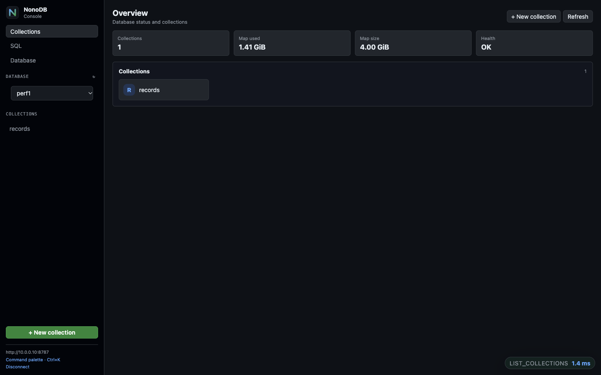
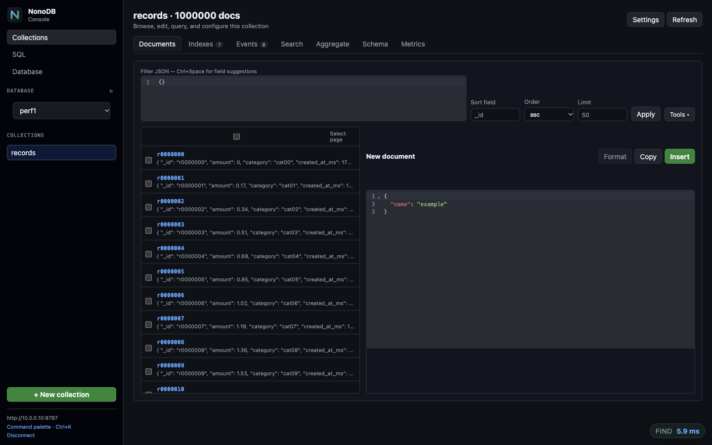
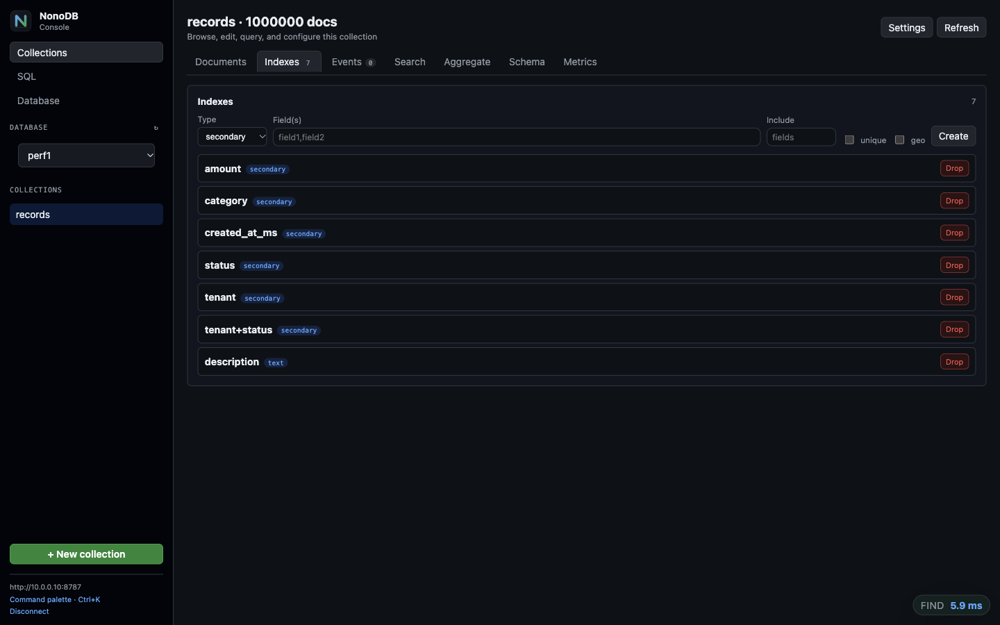
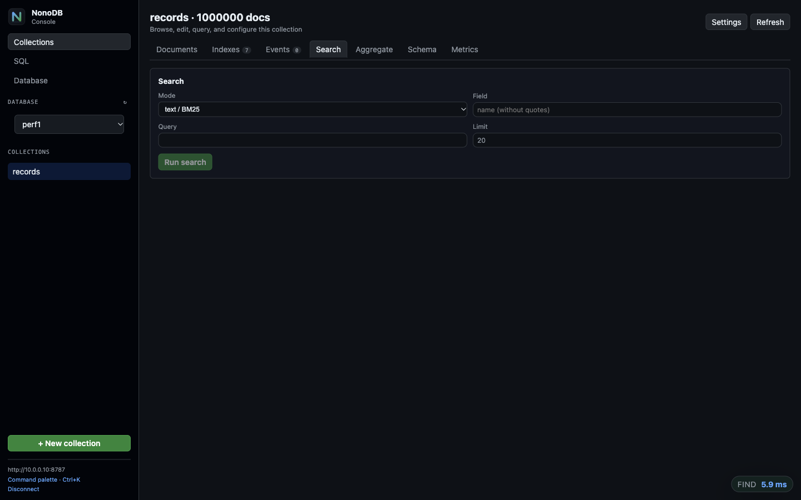
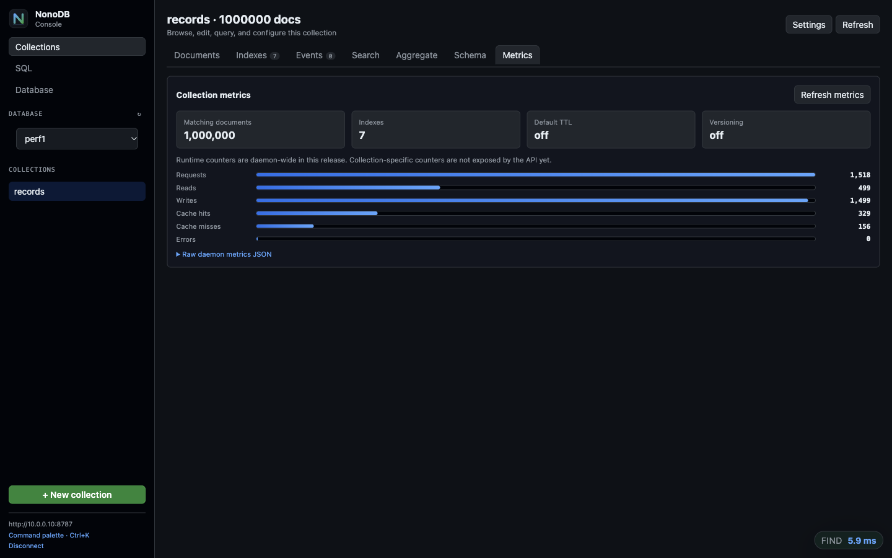
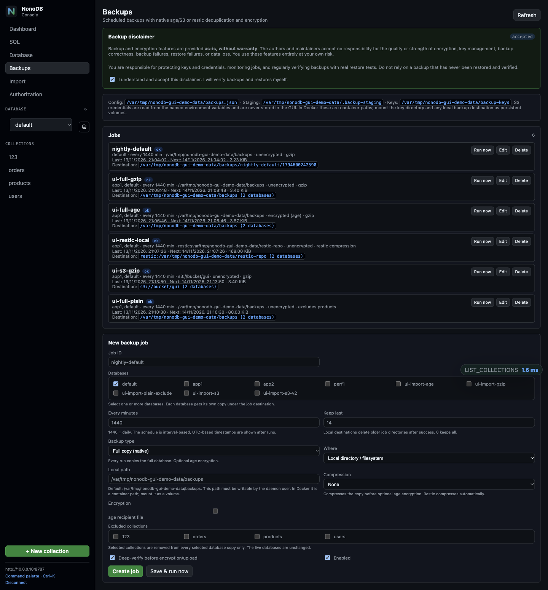
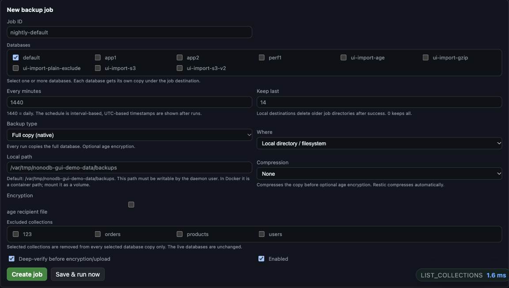
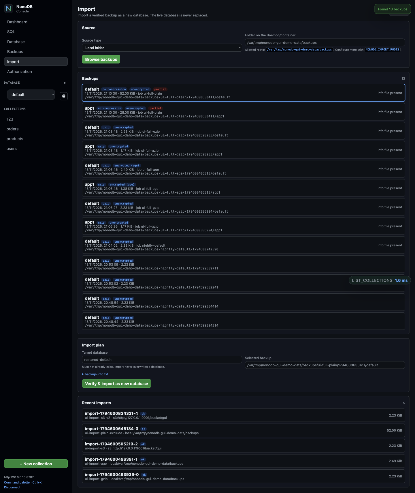
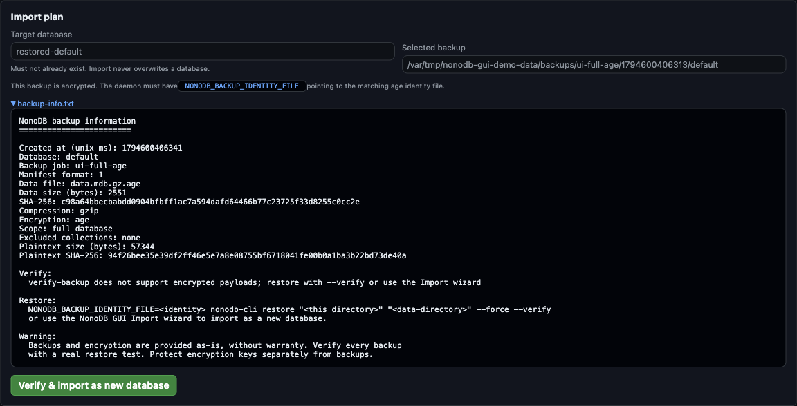

# GUI console

`nonodb-cli` includes a local browser console. The React build is embedded in the
binary through `rust-embed`, so the GUI does not require Node.js at runtime.

```bash
nonodb-cli gui
```

The command starts a loopback HTTP server on `http://127.0.0.1:8787`, opens the
default browser, serves the embedded React application, and proxies API requests
to the daemon over the configured Unix socket or TCP endpoint.

```bash
nonodb-cli gui --port 8788
nonodb-cli gui --no-open
```

The server binds to `127.0.0.1` by default. To listen on another interface you
must pass both `--host` and `--allow-remote`:

```bash
nonodb-cli gui --host 0.0.0.0 --allow-remote
```

To enforce daemon bearer-token authentication, point the GUI proxy at the
daemon's TCP listener instead of the trusted Unix socket:

```bash
nonodb-cli gui --url http://127.0.0.1:7879
```

Unix sockets are treated as trusted local admin connections, so token auth is not
enforced on that path.

Exposing the GUI beyond loopback is only safe with TLS, authentication, and a
trusted reverse proxy or tunnel. The GUI itself does not terminate TLS.

## Screenshots

Overview with the database selector; the example below uses `perf1` with one
million documents:



Documents browser with keyset pagination, filters, sorting, and the document
editor:



Index management, including the automatic index state and text/vector indexes:



Search console for full-text/fuzzy/vector queries:



Runtime metrics and time-series samples:



Backup jobs, the required disclaimer, and the last destination path:



Backup job form with multi-database selection, backup type, destination,
compression, encryption, and excluded collections:



Import wizard showing local/S3 discovery, compression/encryption/partial
status, and `backup-info.txt` availability:



Import plan with target database, selected backup, and the generated
`backup-info.txt` details:



A short walkthrough of switching databases and opening collections:

[Download the GUI walkthrough video (MP4, 16 s)](assets/gui/demo.mp4)

## Connection

The GUI uses the same database credential as the CLI and API: a NonoDB bearer
token. There is no separate GUI account.

- Local GUI connects without a token when daemon authorization is disabled.
- If the GUI process has `NONODB_TOKEN`, the local GUI session endpoint fills
  the token automatically.
- Otherwise enter the token in the single **Database token** field.
- Vault tenant, key id, key, endpoint, database, and saved profiles are under
  **Advanced**.
- The sidebar database selector switches between databases in the same daemon.
  Requests are routed as `/<database>/v1/exec` and `/<database>/v1/watch`.
- The collection list stays visible in the sidebar on every tab. **Dashboard**
  shows the selected database overview and metrics; choosing a collection opens
  its document view.
- The database icon next to the selector opens the **Storage** view with total
  database usage and a per-collection table: records, data, indexes, history,
  TTL, total estimated size, and rolling one-minute traffic. Click a collection
  row to open that collection's **Metrics** tab.

Credentials are kept in browser `sessionStorage` for the active session. Saved
connection profiles use browser `localStorage`; do not save production tokens on
a shared machine. Use **Disconnect** to clear the active session.

## Features

### Documents

- browse with MongoDB-style JSON filters, sorting, pagination, limit, and
  optional projection;
- visual filter builder with nested AND/OR groups, operators, value types, and a
  live JSON preview;
- field autocomplete in the filter editor, document editor, sort, index, and
  search inputs;
- CodeMirror JSON editor with syntax highlighting, folding, validation, format,
  copy, insert, edit, and delete;
- multi-document selection with bulk delete and bulk field update;
- document history viewer with previous-revision comparison and restore;
- import/export as JSON, NDJSON, or CSV, with optional upsert on import;
- saved per-collection views for filter, sort, projection, and limit.

### Indexes

- secondary and compound indexes;
- unique, include, and geo options;
- text/BM25 indexes;
- fuzzy indexes;
- vector indexes with dimensions and metric;
- index listing and removal for every supported type.

### Events

- persistent conditional subscription management;
- create with filter, count condition, operation selection, `once`, and lease;
- renew and delete subscriptions;
- connection-scoped live event viewer using `mode:"live"`;
- live events are pushed directly over the stream and are not stored in
  `_events`.

### Search

- text/BM25;
- fuzzy;
- vector search;
- filter, field, limit, and result viewer.

Text, fuzzy, and vector search require the corresponding index on the field.

### Aggregation

- JSON aggregation pipeline editor;
- runs `$match`, `$group`, `$sort`, `$project`, `$limit`, `$skip`, `$unwind`,
  and other supported stages;
- result viewer and JSON export.

### Schema

- inferred field paths from up to 500 sampled documents;
- detected value types and coverage percentage;
- click a field path to add an `$exists` filter.

### SQL

- SQL console with JSON parameters;
- `EXPLAIN` for SQL;
- query history stored in browser localStorage;
- JSON and CSV result export.

### Metrics

Metrics for the selected database are shown on the **Dashboard**, not in
Database settings.

- database-wide counters, queue, commit, batch, and TTL signals;
- data-disk utilization and snapshot age;
- graphical bars and time-series samples with optional 5-second auto-refresh;
- raw metrics JSON.

Per-collection request/read/write/cache/error counters and latency live in the
selected collection's **Metrics** tab, not on the dashboard.

### Database

- LMDB map size, used/free bytes, and page size;
- online map resize;
- database-wide JSON import/export;
- command helper for backup, restore, and verification CLI operations;
- a note explaining that each database is a separate LMDB environment and the selector switches between them;
- The database icon opens the **Storage** view with per-collection record counts, space usage, and last-minute traffic for the selected database.

### Backups

- create, edit, delete, and manually run backup jobs;
- **Save & run now** next to **Create job** to save and immediately test a job;
- multi-select database list for backing up several databases in one job;
- multi-select excluded collections, applied to every selected database copy;
- a required backup disclaimer acknowledgment before creating or running jobs;
- **Backup type** first (full native copy or restic incremental/deduplicated),
  then **Where** (local filesystem or S3/Cloudflare R2);
- **Compression** option for native jobs: none or gzip, applied before optional
  age encryption; restic compresses automatically;
- local paths default to `<NONODB_DATA>/backups` and
  `<NONODB_DATA>/restic-repo`, so the daemon can write them without root;
- optional age encryption for native destinations, or restic-managed
  encryption and deduplication;
- one-time age key or restic password generation; private key material is never
  displayed or editable in the GUI;
- interval schedule in minutes, retention count, and deep verification;
- last/next run, size, duration, last destination path, and errors;
- automatic refresh while a backup is running and a completion notice with the
  destination path;
- credentials are read from configured environment-variable names and never
  stored in the GUI.

#### Backup workflow

1. Open **Backups** and accept the disclaimer.
2. Select one or more databases.
3. Choose **Backup type**: full native copy or restic incremental/deduplicated.
4. Choose **Where**: local filesystem or S3/Cloudflare R2.
5. For native jobs choose **Compression** and optional age encryption.
6. Optionally exclude collections; exclusions apply to every selected database.
7. Click **Create job** to schedule it, or **Save & run now** to test it
   immediately.
8. After a run, inspect the badge, size, and **Destination** path.

The local destination and key directory default inside `NONODB_DATA`, so the
daemon can write them without root. In Docker, mount every local destination and
`NONODB_BACKUP_KEY_DIR` as persistent volumes.

### Import

- browse local folders under `NONODB_IMPORT_ROOTS` or an S3/R2 prefix;
- see database, timestamp, size, gzip, age, job, and partial-exclusion status;
- read the generated `backup-info.txt` when available;
- import as a new database with checksum, decryption, decompression, and deep
  LMDB verification;
- existing databases are never overwritten.

#### Import workflow

1. Open **Import**.
2. Choose **Local folder** or **S3 / Cloudflare R2**.
3. For local imports, use a path under `NONODB_IMPORT_ROOTS` (default
   `<NONODB_DATA>/backups`). In Docker this is a container path and must be
   mounted.
4. Click **Browse backups**.
5. Select the database backup. Check compression, encryption, partial scope, and
   `backup-info.txt`.
6. Enter a new target database name.
7. Click **Verify & import as new database**.

The importer verifies the checksum, decrypts age with
`NONODB_BACKUP_IDENTITY_FILE` when needed, decompresses gzip, verifies the LMDB
database, and refuses to overwrite an existing database.

### Authorization

- principal list with database-qualified scopes and edit/delete controls;
- one-time bearer token creation with an explicit copy-once warning;
- token enable/disable;
- mTLS certificate registration and enable/disable;
- last-enabled-administrator protection and referenced-principal checks.

### Navigation

- saved connection profiles;
- command palette (`Ctrl+K`) for navigation and collection switching;
- toast notifications;
- recent operation log with backend-side timings.

## Timings

The local GUI proxy adds an `x-nonodb-server-ms` response header measured around
the daemon request. The bottom-right timing badge and the recent-operation log use
that value, so they show backend time plus local socket overhead rather than full
browser round-trip time. Direct connections without the local proxy fall back to
client-side timing.

## Collection settings

Settings are edited in a focused dialog:

- default document TTL in seconds, with an explanation;
- versioning / history retention (`0` disables history);
- automatic collection events.

## Multiple databases

One daemon can host several independent databases, each with its own LMDB
environment under `NONODB_DATA/<database>/`. The sidebar selector switches the
active database and the GUI routes requests to
`/<database>/v1/exec` and `/<database>/v1/watch`; `default` uses the same
routes. No second daemon, socket, port, or GUI instance is needed.

Databases are created and dropped with the CLI or the management API, and the
Import wizard can create one by importing a backup. The GUI does not expose a
standalone "new database" button:

```bash
nonodb-cli databases create app1
nonodb-cli databases list
nonodb-cli databases drop app1
```

Each database has separate collections, indexes, TTL/history/event settings,
and subscriptions. Collections and queries never span databases.

## Docker

The image includes the GUI. Compose can start it as an optional sidecar sharing
the daemon's Unix socket:

```bash
docker compose -f deploy/docker-compose.yml --profile gui up -d
```

Open `http://127.0.0.1:8787`. The Compose mapping publishes only to loopback. The
GUI container runs:

```text
nonodb-cli gui --host 0.0.0.0 --port 8787 --allow-remote --no-open
```

`0.0.0.0` is required inside the container so Docker can forward the published
port; the host mapping remains `127.0.0.1:8787:8787`.

With plain Docker:

```bash
docker run -d --name nonodb-gui \
  -p 127.0.0.1:8787:8787 \
  -v nonodb-run:/run/nonodb \
  -e NONODB_SOCK=/run/nonodb/nonodb.sock \
  ghcr.io/essmos/nonodb:0.22.0 \
  nonodb-cli gui --host 0.0.0.0 --port 8787 --allow-remote --no-open
```

The GUI sidecar needs the daemon's socket volume. Do not publish `8787` on
`0.0.0.0` without TLS and authentication in front of it.

## How the local proxy works

```text
browser ──HTTP──▶ 127.0.0.1:8787 (nonodb-cli gui)
                         │
                         ├── embedded React assets
                         ├── /v1/exec, /healthz, /metrics
                         └── /v1/watch (streamed)
                                      │
                                      ▼
                              nonodb-daemon
                        Unix socket or TCP
```

The browser uses one origin, so there is no CORS setup. Authorization headers and
vault headers are forwarded to the daemon. The daemon remains the authority for
all scopes and permissions. The local proxy streams `/v1/watch` instead of
buffering the whole response.

## Build

The GUI source lives in `gui/` (Vite + React + TypeScript). To rebuild the
embedded assets:

```bash
cd gui
npm ci
npm run build
```

Then rebuild the CLI:

```bash
cargo build --release -p nonodb-cli
```

CI and Docker build the GUI before compiling `nonodb-cli`. A committed
`gui/dist/.gitkeep` keeps a fresh checkout compilable before the frontend build
runs.

## Limitations

- Whole-collection deletion is not exposed yet.
- Import currently supports full-database import from native local/S3 backups;
  selective collection import, restic repository import, and replace-in-place
  restore are not exposed in the GUI.
- Multi-connection profiles exist, but simultaneous multi-daemon tabs do not.
- A light theme is not included.

## Future GUI work

These are planned improvements, not current features.

- **Database management in the GUI.** Create and drop databases directly from
  the console; today the GUI can select databases but creation/drop is CLI-only.
- **Backup and restore UI.** Trigger online backups, list manifests, verify
  checksums, and show restore instructions. Restore itself remains CLI-only
  until a safe daemon-side restore flow exists.
- **Multiple daemon tabs.** Keep several connection profiles open at once
  instead of switching one active connection.
- **Progress and resume for large imports.** Stream import progress, allow
  cancellation, and resume large JSON/NDJSON/CSV imports.
- **Better large-result handling.** Virtualized document lists and resumable
  cursors for very large collections.
- **Light theme.** The current console is intentionally dark-only.
- **Accessibility and keyboard navigation.** Improve focus management, ARIA
  labels, and shortcuts beyond the command palette.
- **Shareable saved views and filters.** Export/import saved views without
  sharing credentials.

## Security notes

- The GUI server listens on loopback by default.
- Non-loopback binding requires explicit `--allow-remote`.
- Static assets are served with CSP, `nosniff`, and no-referrer headers.
- Tokens are never embedded in the frontend bundle.
- The GUI hides actions on API errors, but the daemon still enforces read,
  write, and admin scopes.
- Do not expose the local GUI port through a reverse proxy without TLS and
  authentication.
- For remote access, prefer a Cloudflare Tunnel or another authenticated HTTPS
  tunnel; do not expose `http://127.0.0.1:8787` directly.
