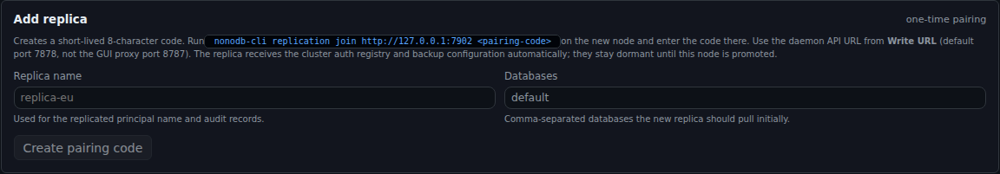
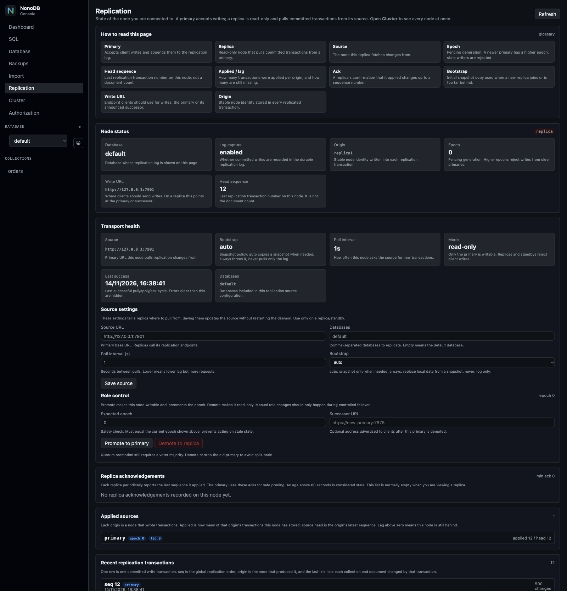
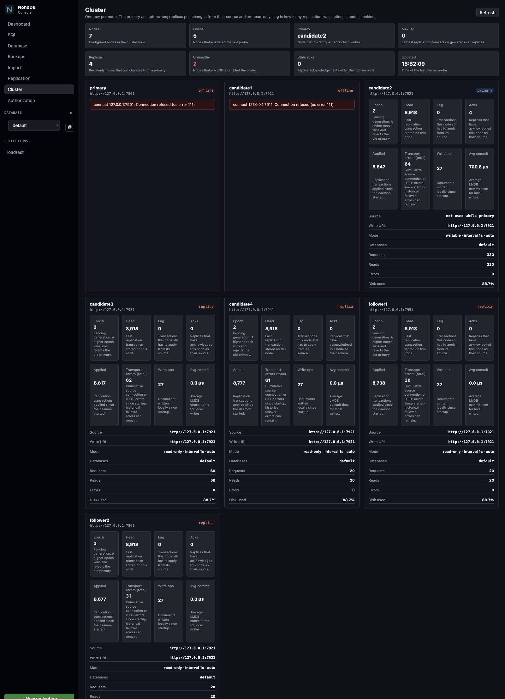

# Replication and cluster guide

This is the practical operator guide for NonoDB replication in `0.25.0` and
later. It covers a primary, read replicas, hot standby, quorum failover, the CLI,
the GUI Cluster view, monitoring, and the common failure modes.

The lower-level design and log format are described in
[Replication design](replication.md).

## 1. Concepts

| Term | Meaning |
|---|---|
| Primary | The only node that accepts client writes. It appends every committed write to the durable replication log. |
| Replica | Read-only node. It pulls changes from a source and applies them atomically. |
| Standby | A replica that is intended to become primary after a controlled failover. |
| Source | The URL a replica pulls from. A replica can also be a source for downstream replicas after promotion. |
| Origin | Stable identity of the writer. It is stored in every replication transaction. |
| Sequence | Monotonic transaction number in a database's replication log. |
| Epoch | Fencing generation. A newer primary has a higher epoch; stale writers are rejected. |
| Head | Last replication transaction stored on a node. It is not a document count. |
| Applied | Last source transaction applied for one origin. |
| Lag | `source_head - applied`; zero means caught up. |
| Ack | A replica's report that it applied up to a sequence. The primary uses acks for safe pruning. |
| Bootstrap | Initial snapshot copy used when a fresh replica joins or is too far behind. |
| Promotion ready | Replica has applied the last observed source head and control-plane snapshot and may be promoted automatically. |
| Control plane | Replicated auth registry, backup jobs/state, database catalog, and cluster peer token. |
| Dormant services | Backup scheduler, TTL, history pruning, subscriptions, and maintenance are loaded on replicas but only run on the primary. |
| Pairing code | Short-lived 8-character bootstrap secret used to enroll a new replica. |

Replication is **pull-based**:

```text
replica ───── outbound pull ─────▶ primary
```

The primary does not need to connect back to a replica.

## 2. What is replicated

The ordered replication stream covers documents and the cluster control plane.

Data-plane operations:

- document `insert`, `update`, and `delete`;
- atomic batch and SQL writes;
- TTL-expiry deletes;
- collection creation;
- TTL settings;
- per-collection history settings and generated history;
- automatic event settings;
- secondary, compound, geo, text, fuzzy, and vector indexes;
- conditional subscription definitions and renewals;
- `_events` outbox documents;
- encrypted vault envelopes (the tenant key is supplied by clients).

Control-plane operations:

- the auth registry snapshot: principals, scopes, token hashes, and certificate
  fingerprints;
- backup job definitions and run state;
- the database catalog (`create_database` / `drop_database`);
- the cluster peer token.

Outbox documents and index definitions are applied in the same replication
transaction as the data that produced them. Replicas build or backfill indexes
locally and maintain them on subsequent applies.

Replicas apply the control plane immediately so every node has the same admin
credentials, backup jobs, and catalog. Write-side services stay dormant until
the node becomes primary.

Not replicated:

- vault keys: vault payloads are replicated as encrypted envelopes, but the
  tenant key is supplied by the client and is not stored by NonoDB;
- local backup artifacts — copy them to S3/R2, restic, or shared storage if the
  new primary must read them;
- node transport identity: bind address, data directory, socket path, and TLS
  server key;
- background job claims — workers must point at the primary or `write_url`.

## 3. Topologies

### 3.1 One primary and one read replica

This is the simplest and recommended starting point:

```text
primary ── async pull ──▶ replica
```

Replicas accept reads, aggregation, SQL `SELECT`, watch, and stream requests.
Client writes return HTTP 403 `read_only`.

### 3.2 Primary plus hot standby

A hot standby is a replica that is allowed to become primary:

```text
primary ──▶ standby
   │
   └──────▶ read replicas
```

Promotion requires a voter majority if voters are configured. A standby should
have `NONODB_REPLICATION_AUTO_FAILOVER=1` and
`NONODB_REPLICATION_CANDIDATE=1`.

### 3.3 Quorum cluster

For automatic failover, configure at least three voters:

```text
primary
  ├── candidate1
  ├── candidate2
  ├── candidate3
  └── candidate4
```

Five voters survive two simultaneous voter failures; three voters survive one.
Non-voting followers receive the new primary URL after an election.

## 4. Requirements

- Every node runs the same NonoDB release.
- Every node has a separate `NONODB_DATA` directory.
- Replica can reach the source URL outbound.
- The source token must have `admin:db` or `*:*`; the replication admin API
  currently has no narrower scope.
- Use TLS/mTLS when nodes communicate over an untrusted network.
- Allow enough disk for the database, replication log, and a temporary snapshot.
- Keep clocks synchronized (NTP) for lease and subscription expiry semantics.

### 4.1 Install and start NonoDB from scratch

Install the released binaries on every node (see [Operations](operations.md#install-a-prebuilt-binary)
for the full systemd and Docker variants):

```bash
TAG=v0.25.0-rc.2
ARCHIVE="nonodb-$TAG-linux-x86_64.tar.gz"
curl -LO "https://github.com/essmos/nonodb/releases/download/$TAG/$ARCHIVE"
curl -LO "https://github.com/essmos/nonodb/releases/download/$TAG/$ARCHIVE.sha256"
sha256sum -c "$ARCHIVE.sha256"
tar -xzf "$ARCHIVE"
sudo install -m 0755 "nonodb-$TAG-linux-x86_64/nonodb-daemon" /usr/local/bin/
sudo install -m 0755 "nonodb-$TAG-linux-x86_64/nonodb-cli" /usr/local/bin/

sudo useradd --system --home /var/lib/nonodb --shell /usr/sbin/nologin nonodb
sudo install -d -o nonodb -g nonodb /var/lib/nonodb /run/nonodb
sudo install -d -m 0750 -o nonodb -g nonodb /etc/nonodb
```

Create the auth registry before starting a TCP listener:

```bash
sudo -u nonodb env NONODB_AUTH_FILE=/etc/nonodb/auth.json nonodb-cli auth init
sudo -u nonodb env NONODB_AUTH_FILE=/etc/nonodb/auth.json nonodb-cli auth token create admin
```

Save the printed token in a secret manager or a root-owned `0600` environment
file. Start the daemon in the foreground for a first test:

```bash
sudo -u nonodb env \
  NONODB_DATA=/var/lib/nonodb \
  NONODB_AUTH_FILE=/etc/nonodb/auth.json \
  NONODB_TCP=0.0.0.0:7878 \
  NONODB_REPLICATION_ENABLED=1 \
  NONODB_REPLICATION_ORIGIN=primary-eu \
  NONODB_REPLICATION_ADVERTISE_URL=https://primary.example.com:7878 \
  nonodb-daemon
```

For a service, install `deploy/nonodb.service`, put the same variables in an
`EnvironmentFile`, then run `systemctl enable --now nonodb`. The GUI is served
by the same daemon when enabled; open `http://<node>:7878/gui` and log in with
the cluster bearer token. See [GUI guide](gui.md).

### 4.2 How a replica finds the primary after a failover

The source URL is not the only copy of the topology. Every node persists its
current source in the hidden node metadata collection. Rediscovery works in
three layers:

1. **Normal source switch**: when the stored source is alive but has been
   demoted, its `/v1/replication/status` returns `successor`. The replica
   switches immediately.
2. **Source is unreachable**: after three failed pull cycles the replica queries
   `NONODB_REPLICATION_SEEDS`, then the configured voters and followers, at
   `GET /v1/replication/primary`. The first node that reports `role=primary`
   becomes the new source.
3. **No local source at all**: a replica or replacement node with no source
   configuration also uses the seed/voter list to join the current primary
   automatically.

A replica that was offline for a long time therefore needs at least one stable
address that still exists. Use DNS names, a load balancer, or a small seed list;
a fixed IP of a node that no longer exists cannot be rediscovered.

```env
# Stable discovery addresses, comma-separated. Include voters or a DNS name
# that follows the current primary.
NONODB_REPLICATION_SEEDS=https://db-1.example.com:7878,https://db-2.example.com:7878

# The source token is used for discovery when no voter/peer token is set.
# Use the same cluster-admin credential for both.
NONODB_REPLICATION_VOTER_TOKEN=<cluster-admin-token>
```

Prefer pairing for credentials: `nonodb-cli replication join` writes the source
and token into the hidden collection. Seeds are only addresses; they do not
grant access.

### 4.3 Where replication state is stored

Replication role, source, vote, lease, and cluster peer token are stored in the
hidden LMDB system collection `<NONODB_DATA>/.node` (sub-database `meta`). They
are node-local, atomic, and never copied into database snapshots. Legacy
`replication-role.json`, `replication-source.json`, `replication-vote.json`,
`replication-lease.json`, and `cluster-peer-token` files from older versions
are imported once and removed. Back up `NONODB_DATA`, but do not copy `.node`
to another node: it identifies this node's role and current source.

## 5. Quick start: existing database becomes primary

Suppose the existing database is on `primary.example.com` and the new replica
runs on `replica.example.com`.

### 5.1 Primary environment

```env
NONODB_DATA=/var/lib/nonodb
NONODB_TCP=0.0.0.0:7878
NONODB_AUTH_FILE=/etc/nonodb/auth.json

NONODB_REPLICATION_ENABLED=1
NONODB_REPLICATION_ORIGIN=primary-eu
NONODB_REPLICATION_ROLE=primary
NONODB_REPLICATION_NODE_ID=primary-eu
NONODB_REPLICATION_ADVERTISE_URL=https://primary.example.com:7878
```

The origin must be unique and must never change after the node starts
replicating. The role is persisted in the hidden node metadata collection
`<NONODB_DATA>/.node`; after the first start it wins over
`NONODB_REPLICATION_ROLE`.

### 5.2 Preferred: pair the replica with an 8-character code

The primary creates a one-time code. The replica redeems it and receives a
cluster credential plus the full control-plane snapshot.

On the primary:

```bash
nonodb-cli replication add-replica replica-eu default
```

`pair` is an alias for the same command. It prints a code such as `K7M4-P9QX`,
valid for 10 minutes, plus the exact `join` command. You can also use
**GUI → Replication → Add replica**.

On the new replica, with its own `NONODB_AUTH_FILE` already initialized:

```bash
export NONODB_SOCK=/run/nonodb-replica.sock
nonodb-cli replication join https://primary.example.com:7878 K7M4P9QX
```

The code can be passed as the third argument or entered when prompted. The
daemon:

1. redeems the code on the primary;
2. stores the returned source and token in the hidden node metadata collection;
3. becomes a read-only replica;
4. applies the primary auth registry, backup configuration, and database
   catalog through the control plane;
5. starts pulling data.

The old local replica admin token is replaced by the replicated cluster auth
registry. Use the primary's cluster admin token from then on.

The code is single-use, expires after 10 minutes, and is rate-limited. It is an
8-character code from an unambiguous 32-character alphabet, not 8 digits.

### 5.3 Manual token alternative

You can still provision a token manually:

```bash
export NONODB_AUTH_FILE=/etc/nonodb/auth.json

nonodb-cli auth principal add replication admin:db
nonodb-cli auth token create replication
```

Store the printed token in a secret manager or a `0600` environment file. It is
used by replicas as `NONODB_REPLICATION_SOURCE_TOKEN`.

### 5.4 Open the network path

Allow the replica IP to reach port `7878` on the primary. Prefer one of:

- a private network or WireGuard;
- TLS on the daemon;
- mTLS with a private CA.

Do not expose plaintext replication to the public internet.

### 5.5 Replica environment

Use a **new, empty data directory**:

```env
NONODB_DATA=/var/lib/nonodb-replica
NONODB_TCP=0.0.0.0:7878
NONODB_AUTH_FILE=/etc/nonodb/replica-auth.json

NONODB_REPLICATION_ENABLED=1
NONODB_REPLICATION_ORIGIN=replica-eu
NONODB_REPLICATION_ROLE=replica
NONODB_REPLICATION_NODE_ID=replica-eu

NONODB_REPLICATION_SOURCE=https://primary.example.com:7878
NONODB_REPLICATION_SOURCE_TOKEN=__REPLICATION_TOKEN__

NONODB_REPLICATION_DATABASES=default
NONODB_REPLICATION_POLL_INTERVAL=1
NONODB_REPLICATION_BATCH=20
NONODB_REPLICATION_BOOTSTRAP=auto

NONODB_REPLICATION_ADVERTISE_URL=https://replica.example.com:7878
```

`BATCH=20` is a safe default for large transactions. The older default of 500
can make a `/v1/replication/changes` response very large when a single write
transaction contains many documents.

If you use pairing, `SOURCE` and `SOURCE_TOKEN` are written by
`replication join`; you do not need to put them in the environment.

Create a local auth file for the replica's own CLI/GUI:

```bash
export NONODB_AUTH_FILE=/etc/nonodb/replica-auth.json
nonodb-cli auth init
```

Do not copy the primary's auth registry unless you intentionally want the same
tokens on both nodes.

### 5.6 Start and verify

Start the primary first, then the replica.

On the replica:

```bash
export NONODB_SOCK=/run/nonodb.sock

nonodb-cli replication status
nonodb-cli replication changes 0 5
nonodb-cli replication acks
nonodb-cli ready
```

Expected status:

```json
{
  "role": "replica",
  "read_only": true,
  "promotion_ready": true,
  "replication": {
    "source": "https://primary.example.com:7878",
    "bootstrap": "auto",
    "interval_secs": 1
  }
}
```

Reads work:

```bash
nonodb-cli find orders '{}'
nonodb-cli count orders '{}'
```

Writes are rejected:

```json
{
  "code": "read_only",
  "message": "replica is read-only; promote this node before accepting writes"
}
```

The first start downloads a full snapshot when the local database is fresh.
Large databases can take a long time and require temporary disk space.

### 5.7 Reversed direction

If the server on the other side must be primary, swap the roles:

```text
remote server = primary, accepts writes
local server  = replica, pulls from the remote source
```

Set `NONODB_REPLICATION_ROLE=replica` and
`NONODB_REPLICATION_SOURCE=https://remote-primary:7878` on the local node, and
the primary settings on the remote node.

## 6. TLS and mTLS

### 6.1 Server TLS on the primary

```env
NONODB_TLS_CERT=/etc/nonodb/tls/server.crt
NONODB_TLS_KEY=/etc/nonodb/tls/server.key
```

### 6.2 mTLS on the primary

```env
NONODB_TLS_CERT=/etc/nonodb/tls/server.crt
NONODB_TLS_KEY=/etc/nonodb/tls/server.key
NONODB_TLS_CLIENT_CA=/etc/nonodb/tls/client-ca.crt
NONODB_TLS_CLIENT_AUTH=required
```

### 6.3 Replica client settings

```env
NONODB_REPLICATION_SOURCE=https://primary.example.com:7878
NONODB_REPLICATION_CA_FILE=/etc/nonodb/tls/ca.crt
NONODB_REPLICATION_CERT_FILE=/etc/nonodb/tls/replica.crt
NONODB_REPLICATION_KEY_FILE=/etc/nonodb/tls/replica.key
```

When the client certificate is registered as an `admin:db` principal, the source
token can be omitted. See [Mutual TLS](mtls.md).

TLS server certificates and the client CA are reloaded without restarting:

```env
NONODB_TLS_RELOAD_INTERVAL=30
```

## 7. CLI reference

Run against the local daemon using `NONODB_SOCK`, or use the GUI/API over TCP.

```bash
nonodb-cli replication status
nonodb-cli replication primary
nonodb-cli replication changes 0 100
nonodb-cli replication acks
nonodb-cli replication source https://primary.example.com:7878 default,app1 1
nonodb-cli replication prune 1234 --require-acks
nonodb-cli replication promote <epoch>
nonodb-cli replication demote <epoch> replica [successor-url]
```

| Command | Purpose |
|---|---|
| `status` | Role, epoch, head, write URL, source, bootstrap, applied sources, lag, acks, errors, `promotion_ready`. |
| `primary` | Current write endpoint and role. Useful for load balancers and scripts. |
| `changes [after] [limit]` | Read the durable replication log. Use an `after` checkpoint for consumers. |
| `acks` | Replica acknowledgement sequences and ages. |
| `source <url> [dbs] [interval]` | Change the pull source without restarting. |
| `pause` | Stop pulling/applying while keeping the source and token. |
| `resume` | Resume a paused replica from the stored source. |
| `disconnect` | Remove source/token and leave the node read-only; data is kept. |
| `forget <node>` | Remove a stale ACK row on the primary. |
| `prune <seq> [--require-acks]` | Remove old log records, optionally refusing to pass the minimum ack. |
| `add-replica <name> [dbs]` (alias `pair`) | Create a one-time 8-character pairing code on the primary. |
| `pairings` | List pending pairing codes. |
| `revoke <code>` | Revoke a pending pairing code. |
| `join <primary-url> [code]` | Redeem a code on the replica and install the source/control plane. |
| `promote <epoch>` | Manual promotion. Requires the expected epoch. |
| `demote <epoch> replica [successor]` | Manual demotion, optionally advertising a successor. |

The CLI does **not** configure voters, followers, leases, candidate priorities,
TLS paths, or retention. Those are startup environment settings.

### 7.1 Environment reference

| Variable | Default | Meaning |
|---|---|---|
| `NONODB_REPLICATION_ENABLED` | `0` | Enable durable log capture on a writer. |
| `NONODB_REPLICATION_ORIGIN` | node id / `local` | Stable writer identity. |
| `NONODB_REPLICATION_ROLE` | `primary` | Seeds the hidden role state: `primary`, `replica`, or `standby`. |
| `NONODB_REPLICATION_NODE_ID` | node id / `local` | Replica identity used in acks. |
| `NONODB_REPLICATION_SOURCE` | unset | Source base URL. |
| `NONODB_REPLICATION_SOURCE_TOKEN` | unset | Bearer token for source replication API. |
| `NONODB_REPLICATION_DATABASES` | `default` | Comma-separated databases to pull. |
| `NONODB_REPLICATION_POLL_INTERVAL` | `1` | Seconds between pulls. |
| `NONODB_REPLICATION_BATCH` | `500` | Transactions per `/changes` request, clamped to 1–1000. |
| `NONODB_REPLICATION_BOOTSTRAP` | `auto` | `auto`, `always`, or `never`. |
| `NONODB_REPLICATION_EXIT_ON_GAP` | `0` | Ask the supervisor to restart on a runtime gap so startup can resync. |
| `NONODB_REPLICATION_ADVERTISE_URL` | unset | Public URL used for write routing and promotion. |
| `NONODB_REPLICATION_VOTERS` | unset | Comma-separated voter URLs. Empty disables quorum and leases. |
| `NONODB_REPLICATION_VOTER_TOKEN` | unset | Shared token used to call voter endpoints. |
| `NONODB_REPLICATION_FOLLOWERS` | unset | Non-voting nodes that receive the new primary URL. |
| `NONODB_REPLICATION_SEEDS` | unset | Stable addresses queried to rediscover the primary when the stored source is unreachable. |
| `NONODB_REPLICATION_LEASE_INTERVAL` | `5` | Primary quorum lease renewal interval. |
| `NONODB_REPLICATION_LEASE_TTL` | `15` | Time without majority before a primary self-demotes. |
| `NONODB_REPLICATION_AUTO_FAILOVER` | `0` | Enable candidate election. |
| `NONODB_REPLICATION_CANDIDATE` | `0` | Mark this node as an election candidate. |
| `NONODB_REPLICATION_CANDIDATE_PRIORITY` | `0` | Extra seconds before campaigning; lower is preferred. |
| `NONODB_REPLICATION_ELECTION_INTERVAL` | `5` | Candidate polling interval. |
| `NONODB_REPLICATION_FAILOVER_TIMEOUT` | `30` | Source failure duration before election starts. |
| `NONODB_REPLICATION_PRUNE_INTERVAL` | `0` | Automatic retention interval. |
| `NONODB_REPLICATION_RETENTION_KEEP` | `0` | Extra sequences kept behind the minimum ack. |
| `NONODB_REPLICATION_CA_FILE` | unset | CA bundle for source TLS. |
| `NONODB_REPLICATION_CERT_FILE` | unset | Client certificate for source mTLS. |
| `NONODB_REPLICATION_KEY_FILE` | unset | Client private key. |
| `NONODB_CLUSTER_PRUNE_DATABASES` | `1` | Drop local non-default databases that disappear from the replicated catalog. Set `0` to keep them. |

## 8. Quorum and failover

### 8.1 Voter configuration

Use an odd number of voters, normally three or five:

```env
NONODB_REPLICATION_VOTERS=https://primary:7878,https://candidate1:7878,https://candidate2:7878
NONODB_REPLICATION_VOTER_TOKEN=__SHARED_ADMIN_TOKEN__
```

Set the same voter list on every voter. Set `NONODB_REPLICATION_ADVERTISE_URL`
on every node.

### 8.2 Lease-gated writes

The primary renews a quorum lease. Client writes are accepted only when the
node is both `primary` and holds a valid lease. A primary with configured voters
starts read-only; it does not accept writes until it reaches a voter majority.

If it loses the voter majority for `NONODB_REPLICATION_LEASE_TTL`, it
self-demotes and becomes read-only. Automatic candidates also wait out the lease
TTL before campaigning, so a fast election cannot create two writers.

```env
NONODB_REPLICATION_LEASE_INTERVAL=5
NONODB_REPLICATION_LEASE_TTL=15
```

### 8.3 Candidates

On selected replicas:

```env
NONODB_REPLICATION_AUTO_FAILOVER=1
NONODB_REPLICATION_CANDIDATE=1
NONODB_REPLICATION_CANDIDATE_PRIORITY=0
NONODB_REPLICATION_ELECTION_INTERVAL=1
NONODB_REPLICATION_FAILOVER_TIMEOUT=10
```

Lower priority campaigns first. A higher priority waits longer, so the preferred
candidate normally wins.

Automatic election requires `promotion_ready=true`: the candidate must have
applied the last observed source head **and** the replicated control-plane
snapshot. A lagging candidate waits instead of promoting stale data or missing
auth/backup configuration.

### 8.4 Write routing

The current write endpoint is exposed in:

```text
GET /v1/replication/primary
GET /readyz/write
```

`GET /readyz/write` returns the write URL and readiness. A read-only node also
returns a `Location` header on rejected writes, so clients and proxies can
retry against the new primary.

Example load-balancer rule:

```text
if path starts with /v1/exec and method is POST:
    follow /readyz/write
    retry once on 403 read_only using Location
```

### 8.5 Manual failover

For a controlled move:

1. stop writes to the old primary;
2. demote it:

```bash
nonodb-cli replication demote <epoch> replica https://new-primary:7878
```

3. promote the target:

```bash
nonodb-cli replication promote <epoch>
```

4. verify `replication status`, lag, and `write_url`;
5. point clients at the new `write_url`.

Without voters there is no quorum. Stop or demote the old primary before
promoting a replica.

### 8.6 Returning old primary

When a partitioned primary loses its lease it self-demotes and becomes
read-only. After connectivity returns, source discovery queries the voters for
the current primary and installs it as the source. If the old log diverged, the
replica resets its local replication state in place and re-pulls the source log;
divergent local writes are discarded rather than merged. If the source log has
already been pruned, the normal gap/snapshot recovery applies.

The network-partition test covers this path:

```bash
python3 scripts/replication_partition_test.py
python3 scripts/replication_vault_test.py
```

It cuts a live primary from voters and replicas, verifies it self-demotes and
rejects writes, waits for a new quorum primary, restores the links, and checks
that the old primary rejoins as a read-only replica.

## 9. GUI guide

The GUI has two relevant pages: **Replication** for the connected node and
**Cluster** for all configured nodes.

### 9.1 Start the GUI

```bash
NONODB_TOKEN=<token> \
NONODB_CLUSTER_TOKEN=<token> \
nonodb-cli gui \
  --host 10.0.0.10 \
  --allow-remote \
  --url http://127.0.0.1:7878 \
  --cluster primary=https://primary.example.com:7878,replica=https://replica.example.com:7878
```

`--cluster` accepts `name=url,name=url`. `NONODB_CLUSTER_TOKEN` is used for
remote probes; it falls back to `NONODB_TOKEN`.

Cluster probes currently require `http://` URLs. Put HTTPS nodes behind a local
TLS-terminating proxy, or access them over a private network.

### 9.2 Add replica

The **Replication** page on a primary contains an **Add replica** panel:

1. enter the replica name and initial databases;
2. choose **Create pairing code**;
3. copy the 8-character code, then on the new node start the daemon with
   `NONODB_REPLICATION_ROLE=replica` and run
   `nonodb-cli replication join <primary-api-url> <code>` (or paste the code
   when prompted). Use the URL shown under **Write URL** (default daemon port
   `7878`; a custom `NONODB_TCP` port is valid). Do **not** use the GUI proxy
   port (`8787` by default) — `replication join` talks to the daemon API;
4. the pending list shows unused codes and lets you revoke them.




The replica receives the auth registry and backup configuration automatically.
The control plane is dormant until the node is promoted.

### 9.3 Replication page



Use this page to inspect the node you are connected to:

- role, epoch, origin, write URL, head sequence;
- source, bootstrap mode, poll interval, read-only state;
- last successful pull;
- applied sources and lag;
- replica acknowledgements;
- source settings;
- manual promote/demote;
- recent replication transactions.

The page includes an inline glossary and a description under every field.
On a primary, transport source fields are marked as not used while primary.

### 9.4 Cluster page



The screenshot shows a clean three-node demo cluster: one primary and two
replicas, all online, with zero lag and two replica acknowledgements.

The Cluster tab probes every configured node in parallel and shows:

- node name and URL;
- role and epoch;
- head, lag, acks;
- applied transactions and transport errors;
- source and write URL;
- read-only/writable mode;
- requests, reads, writes, errors, disk use;
- offline nodes without blocking the rest of the view.

The view refreshes automatically. Unreachable nodes are shown as `offline`.

### 9.5 Live load test panel

When a benchmark is running and the GUI is started with
`--progress-file <path>` or `NONODB_GUI_TEST_PROGRESS`, the Cluster tab also
shows a **Live load test** panel with phase, loaded documents, percent, rate,
nodes online, writes, primary, and epoch.

### 9.6 Pause and disconnect

A replica or standby can be paused without losing its source:

```bash
nonodb-cli replication pause
nonodb-cli replication resume
```

`disconnect` is stronger: it removes the source and token and leaves the node
read-only. It does not delete collections or history. Promote the node separately
if it should become standalone, and use a new pairing code to reconnect it later.
The **Replication** page exposes the same controls with confirmation.

### 9.6 Network tab

A replica should set `NONODB_REPLICATION_ADVERTISE_URL` to an address reachable
from the primary/GUI host. The URL is carried in replication acknowledgements.
The primary stores it, and the GUI automatically probes advertised `http://`
replicas for full Cluster metrics. Without it, the replica still appears through
its ACK but only with node id, sequence, and freshness.

The **Network** tab contains the actual listener bind and the host firewall
controls. This is where you verify that the primary is reachable before adding
a remote replica:

- TCP bind must be `0.0.0.0` or a LAN address, not `127.0.0.1`;
- the advertised replication URL must be reachable from replicas;
- the managed nftables table can allow only selected source CIDRs on the NonoDB
  ports.

Firewall apply is opt-in with `NONODB_FIREWALL_MANAGE=1`; on a non-root service
use `NONODB_FIREWALL_SUDO=1` with passwordless sudo. The managed table is
separate from SSH and general host policy. See [Operations](operations.md#host-firewall-nftables).

## 10. Monitoring## 10. Monitoring

Prometheus exposes replication metrics at `/metrics/prometheus` with a
`metrics:read`, `admin:db`, or `*:*` token. JSON metrics are also available at
`/metrics`.

Important metrics:

```text
nonodb_replication_enabled
nonodb_replication_head
nonodb_replication_role{role="primary|replica|standby"}
nonodb_replication_applied{origin="..."}
nonodb_replication_applied_epoch{origin="..."}
nonodb_replication_lag{origin="..."}
nonodb_replication_source_head{origin="..."}
nonodb_replication_ack_nodes
nonodb_replication_min_ack
nonodb_replication_ack_seq{node="..."}
nonodb_replication_ack_age_seconds{node="..."}
nonodb_replication_transport_errors_total
nonodb_replication_apply_errors_total
nonodb_replication_applied_total
nonodb_replication_pruned_total
nonodb_replication_retention_runs_total
```

Recommended alerts:

- no primary for more than N seconds;
- replica lag above policy;
- applied sequence stalled;
- apply error growth;
- stale replica acks;
- primary lease lost;
- TLS/mTLS handshake failures;
- log retention/disk pressure.

See [Monitoring](monitoring.md) and
[Prometheus alerts](../deploy/prometheus-alerts.yml).

## 11. Backup versus replication

Replication is not a backup.

| Replication | Backup |
|---|---|
| Protects against node failure | Protects against data loss and logical mistakes |
| Async and continuous | Point-in-time snapshot |
| Replica is read-only | Restore creates a database/file |
| Does not protect against `DELETE` replicated everywhere | Restores from an earlier copy |
| Needs a network path and token | Can be local, S3, R2, or restic |

Keep both. Take regular snapshots even when a replica is healthy.

## 12. Troubleshooting

| Symptom | Likely cause | Fix |
|---|---|---|
| `connect: No such file or directory` on `replication join` | Local replica daemon/socket is missing, or `NONODB_SOCK` is wrong | Start the replica daemon and set `NONODB_SOCK` to its socket. `join` talks to the local daemon; the primary URL is only the source. On macOS/Linux use the Unix socket, not `NONODB_URL`. |
| `401 unauthorized` / `403 forbidden` on replication | Source token missing or lacks `admin:db` | Create a dedicated `admin:db` token on the source. |
| `read_only` on every write | Node is a replica/standby | Write to primary or promote the node. |
| `promotion_ready=false` | Candidate is behind the last observed source head | Wait for lag to reach zero; check `/v1/replication/changes`. |
| `replication gap` or snapshot resync loop | Source log gap or pruned records | Use `BOOTSTRAP=auto`, allow snapshot; keep enough retention. |
| Large memory spike on primary | `/changes` response is too large | Set `NONODB_REPLICATION_BATCH=10` or `20`, reduce write batch size. |
| High lag during bulk load | Replica index build or disk I/O | Check apply errors, disk, index progress; increase poll frequency only after fixing the bottleneck. |
| Transport error points at an old node | Historical error from before source switch | Check `last_success_unix`; the GUI hides stale errors. |
| `epoch_mismatch` | Manual promote/demote used a stale epoch | Read current epoch from `replication status` and retry. |
| `quorum_not_reached` | Too few voters reachable | Restore voter majority or use explicit manual recovery. |
| TLS handshake failure | Missing CA, client certificate, or hostname mismatch | Check `NONODB_REPLICATION_CA_FILE`, `CERT_FILE`, `KEY_FILE`, and server cert SANs. |
| Replica starts with old data | Non-empty `NONODB_DATA` or persisted role | Use a fresh directory or intentionally bootstrap with `always`. |

## 13. Known limitations

- Vault payloads are replicated as encrypted envelopes; tenant keys are
  client-supplied and are never stored in the control plane. A replica can read
  the data only with the same key.
- Auth, backup jobs, and the database catalog are replicated; TLS transport
  identity, data/socket paths, log level, worker counts, and other node-local
  settings are not.
- Backup job definitions and run state are replicated, but backup artifacts are
  not. Use S3/R2, restic, or shared storage if a new primary must read them.
- Background workers must target the primary/`write_url`; job claims are writes.
- History pruning is paused while a node is read-only. It resumes after
  promotion. The backup scheduler is also primary-only.
- Subscription lease expiry can shift slightly when recreated on a replica.
- Mixed-version rolling upgrades: old replicas ignore the new metadata operation
  field. Upgrade all nodes before relying on metadata replication.
- Cluster GUI probes currently use HTTP URLs; use a local TLS proxy for HTTPS.
- Failover is asynchronous. A small RPO window exists unless writes are stopped
  before promotion. Divergent writes from an isolated old primary are discarded
  on resync, not merged.
- The cluster peer token is stored in the control plane so every node can follow
  a new primary. It is kept in the hidden local metadata collection
  `<NONODB_DATA>/.node`; protect the data directory accordingly.
- A hard resync resets local collections and replication state in place. If the
  source log was pruned, use snapshot bootstrap or restart with
  `NONODB_REPLICATION_EXIT_ON_GAP=1`.

## 14. Validation scripts

The repository includes focused integration tests:

```bash
python3 scripts/replication_test.py
python3 scripts/replication_failover_test.py
python3 scripts/replication_lease_test.py
python3 scripts/replication_election_test.py
python3 scripts/replication_cluster_test.py
python3 scripts/replication_metadata_test.py
python3 scripts/replication_control_plane_test.py
python3 scripts/replication_discovery_test.py
python3 scripts/replication_lease_gate_test.py
python3 scripts/replication_partition_test.py
python3 scripts/replication_load_test.py --docs 200000 --keep
python3 scripts/tls_reload_test.py
python3 scripts/gui_cluster_test.py
```

`replication_load_test.py` runs a multi-host load, joins nodes during the load,
performs two quorum failovers, records throughput/latency/convergence, and
enforces memory limits.

## 15. Security checklist

- Use TLS/mTLS between nodes.
- Never expose the replication API directly to the public internet.
- Pairing issues a per-replica `admin:db` credential. This cluster model is
  deliberately cluster-wide administration: every full member can become
  primary and can read the replicated data.
- The cluster peer token is replicated in the control plane and kept in the
  hidden local metadata collection. Protect every node's data directory as an
  administrator-equivalent secret.
- Store manual tokens in a secret manager or a `0600` environment file.
- Restrict source access by firewall or private network. The **Network** tab
  generates a dedicated nftables table for NonoDB ports; never replace the
  general host firewall from an automated UI.
- Rotate certificates and tokens.
- Keep NTP enabled.
- Back up the database even with a healthy replica.
- Monitor lag, apply errors, acks, leases, and disk.
