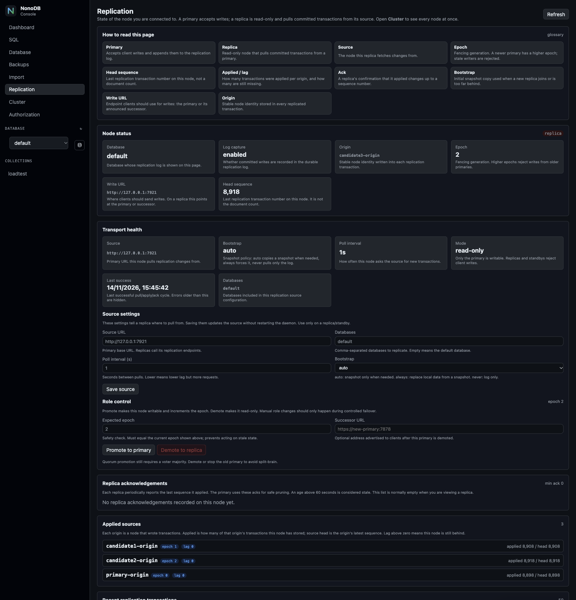
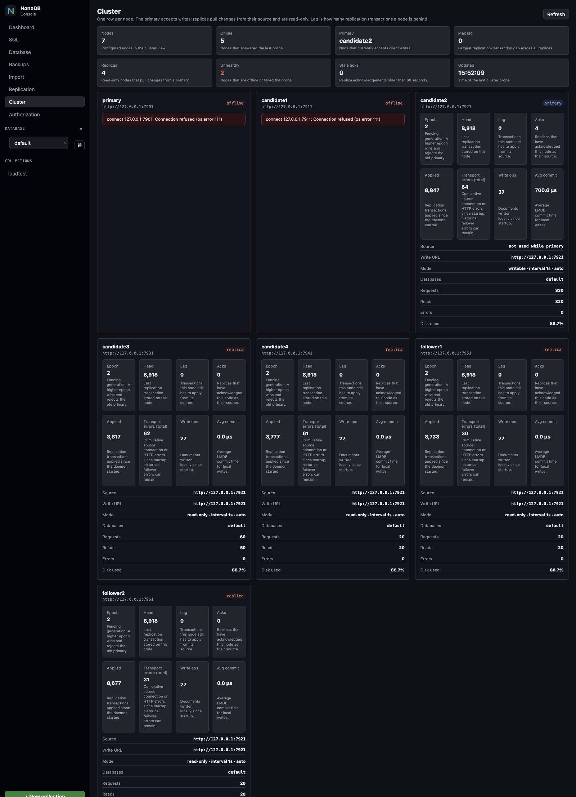

# Replication design

This page describes the planned multi-region replication model. It is separate
from [backup and restore](backup.md): backups protect against history, while
replication keeps independent NonoDB nodes close to users.

## Goals

- Local reads in every region.
- A simple primary → replica path first.
- A hot standby with controlled failover.
- Same ports and same GUI binary on every node.
- A role-aware GUI that clearly shows primary, replica, standby, lag, and
  failover state.
- Mandatory TLS 1.3 + mTLS for node-to-node replication across providers.
- Replication lag, sequence, certificate expiry, and apply failures in
  Prometheus and the GUI.
- No silent split-brain or last-write-wins default.

## Non-goals for the first version

- Full master-to-master writes to the same document.
- Tenant-aware write routing.
- CRDTs or field-level merge policies.
- Quorum payments in the initial replication slice.
- Network replication over plaintext.

## Topology

Start with:

```text
global router / GeoDNS
        │
        ├── primary region      (all writes)
        ├── hot standby         (sync or async)
        └── read replicas       (local reads)
```

Every node uses the same ports:

```text
7878  daemon API + /v1/replication/*
8787  local GUI proxy
```

Replication is pull-based:

```text
replica ──outbound mTLS──▶ primary
```

This works across NAT and providers without requiring inbound access to every
replica.

## Consistency profiles

| Data | Recommended mode | Failure behaviour |
|---|---|---|
| Profiles, content, feeds | primary + async read replicas | small RPO acceptable |
| Orders | home-region owner + one sync replica | no acknowledged write loss on single-region failure |
| Payments | leader per account/payment + quorum | reject writes without quorum; external ledger reconciliation |

The initial implementation targets the first two. Payments remain outside the
first replication slice until quorum, fencing, and audit semantics are complete.

## Durable replication log

The core now contains the first foundation: `nonodb_core::replication`.

Each database has an internal `_replication` LMDB sub-database. A record stores
one committed write transaction, preserving transaction grouping and the single
writer order:

```json
{
  "seq": 1042,
  "origin": "eu-1",
  "created_at_ms": 1794600000000,
  "changes": [
    {
      "collection": "orders",
      "op": "update",
      "id": "o-123",
      "before": {"_id":"o-123","status":"pending"},
      "after": {"_id":"o-123","status":"paid"}
    }
  ]
}
```

Implemented core primitives:

- `Store::append_replication_txn_in()`
- `Store::replication_after()`
- `Store::replication_head()`
- `Store::prune_replication_through()`

The daemon writer now appends normal CRUD, SQL, atomic batch, and TTL-expiry
changes in the same LMDB transaction as the data. Vault writes and some internal
configuration changes are not yet captured. Set `NONODB_REPLICATION_ENABLED=1` and `NONODB_REPLICATION_ORIGIN` to
enable logging.

Read-only inspection endpoints:

```text
GET /v1/replication/status
GET /v1/replication/changes?after=0&limit=100
```

## Replica apply rules

- Apply one whole replication transaction as one local write transaction.
- Reject older `owner_epoch` values after failover.
- Apply `(origin, seq)` idempotently.
- Preserve deletes with tombstones.
- Do not regenerate local application events during replication apply unless
  explicitly configured.
- Rebuild indexes on the replica.
- Deep-verify snapshots before installing them.

## Bootstrap and resync

1. Create a consistent snapshot with `copy_to_file`.
2. Record the snapshot replication sequence.
3. Import the snapshot into a new database.
4. Start pulling changes after that sequence.
5. Verify lag reaches zero.
6. Only then mark the replica ready for reads.

A resync must be resumable and must not expose a half-installed database.

## Transport security

- TLS 1.3.
- Private CA.
- One certificate per node.
- Optional client certificates for normal API traffic; required for
  `/v1/replication/*`.
- Certificate rotation and expiry monitoring.
- Firewall allow-list between known peers.
- NTP on all nodes.
- Optional WireGuard as defence in depth; not a replacement for mTLS.

The replication identity is a node certificate, not a shared bearer token.

## GUI behaviour

The same GUI runs on every node and reads:

```http
GET /v1/replication/status
```

Primary:

```text
[ PRIMARY ] eu-1 · writes enabled · 2 replicas connected
max lag 0.4 s · last seq 10,422
```

Replica:

```text
[ REPLICA ] us-1 · read-only · source eu-1 · lag 0.8 s
last applied seq 10,418
```

The GUI disables normal write controls on a replica and exposes replication
actions to administrators:

- add peer,
- test connection,
- pause/resume,
- resync,
- promote standby,
- demote primary.

Promote/demote require explicit confirmation and an audit entry. Private keys
are referenced by daemon/container paths and are never uploaded through the
browser.

## Monitoring

Planned metrics:

```text
nonodb_replication_role{node,region}
nonodb_replication_peer_connected{peer,region}
nonodb_replication_lag_seconds{peer,region}
nonodb_replication_lag_bytes{peer,region}
nonodb_replication_last_sent_seq{peer}
nonodb_replication_last_applied_seq{peer}
nonodb_replication_pending_changes{peer}
nonodb_replication_apply_errors_total{peer}
nonodb_replication_retries_total{peer}
nonodb_replication_bytes_total{peer}
nonodb_replication_tls_handshake_errors_total{peer}
nonodb_replication_cert_expiry_seconds{peer}
nonodb_replication_failovers_total
nonodb_replication_conflicts_total
nonodb_replication_bootstrap_progress{peer}
nonodb_replication_log_retention_bytes
```

Alerts:

- peer disconnected,
- lag above policy,
- stalled applied sequence,
- apply error growth,
- certificate expiring,
- no standby,
- failover,
- replication log disk pressure.

`/readyz` will be role-aware: a replica is not ready for reads while
bootstrapping or above its allowed lag threshold; a primary is not ready for
writes without the required standby/quorum.

## Current pull replica

A node with `NONODB_REPLICATION_ROLE=replica` or `standby` rejects client writes
and pulls from `NONODB_REPLICATION_SOURCE`:

```text
GET /v1/replication/status
GET /v1/replication/changes?after=N&limit=500
```

`NONODB_REPLICATION_SOURCE_TOKEN` is optional when the source authenticates the
client certificate. `NONODB_REPLICATION_CA_FILE`,
`NONODB_REPLICATION_CERT_FILE`, and `NONODB_REPLICATION_KEY_FILE` enable mTLS.

Apply is atomic per source transaction and idempotent for the global source
sequence. Replicas append each applied transaction to their own local log, so a
promoted replica can serve downstream replicas. The local log sequence matches
the source sequence. A gap returns an error instead of skipping transactions.
Apply invalidates the replica query cache, and transport/apply failures are
counted and exposed through status/GUI. `/readyz` reports the role and does not
require the writer on a read-only replica.

A promoted replica that should act as a source for other replicas must have
`NONODB_REPLICATION_ENABLED=1` so new local writes are captured. Mixed origins
are supported by the global applied sequence; epochs are tracked per origin.

Before the daemon opens its runtime, a fresh replica can install a consistent
source snapshot:

```text
GET /v1/replication/snapshot
POST /v1/replication/prune   {"through": N}
```

Replicas acknowledge the applied sequence to the source after each successful
batch. The source records acks per node and origin. Prune can require them:

```http
POST /v1/replication/prune
{"through": 1234, "require_acks": true}
```

The effective prune point is capped at the minimum acknowledged replica
sequence. Replicas refresh their acknowledgement while idle, so
`ack_age_seconds` reflects liveness rather than just write activity. If no replica has acknowledged the source, the request fails with
`no_replica_acks`. Set `NONODB_REPLICATION_NODE_ID` on every replica so acks are
distinguishable.

Automatic retention is opt-in:

```env
NONODB_REPLICATION_PRUNE_INTERVAL=60
NONODB_REPLICATION_RETENTION_KEEP=0
```

Every interval the primary prunes through `min_ack - keep`, but never beyond
the current log head. With no replica acks nothing is pruned. Set `keep` above
zero for a safety margin.

`NONODB_REPLICATION_BOOTSTRAP=auto` installs a snapshot when the local database
is fresh, or when the source log no longer contains the next sequence the
replica needs. `always` installs one on every start; `never` disables bootstrap.
The snapshot's own replication head becomes the initial applied sequence, so
changes after that point are pulled normally.

The gap check runs at startup, before the runtime opens. If a gap appears while
the daemon is running, the pull loop reports an error. With
`NONODB_REPLICATION_EXIT_ON_GAP=1` it also requests a graceful shutdown; a
supervisor such as systemd, Docker, or Kubernetes restarts the replica and the
startup gap check installs a fresh snapshot. Without a supervisor, restart the
replica manually. Hot resync inside one process is still future work.

### Changing the source

The active pull source is reloaded from `<NONODB_DATA>/replication-source.json`
on every loop. Update it without restarting:

```http
PUT /v1/replication/source
{
  "source": "https://new-primary:7878",
  "databases": ["default", "app1"],
  "interval_secs": 1,
  "bootstrap": "auto"
}
```

Env values seed a new installation; the persisted file wins afterwards. Token,
CA, client certificate, and key remain environment settings. The new source
must expose a compatible sequence/epoch stream, or the replica must be restarted
so startup bootstrap can install a fresh snapshot.

#### Write routing

`GET /v1/replication/primary` returns the best-known write endpoint:

```json
{
  "role": "replica",
  "epoch": 2,
  "write_url": "https://new-primary:7878"
}
```

The same value is exposed as `write_url` in replication status and
`/readyz.replication.write_url`. A load balancer or client can poll a stable
node and route writes to this URL. The endpoint requires `admin:db`; `/readyz`
is unauthenticated for lightweight health routing.

For write pools, use:

```text
GET /readyz/write
```

It returns `200` only on a writable primary. A replica returns `503` and sets
`Location` to the known primary URL. A write request that reaches a replica and
fails with `read_only` also includes the same `Location` header, so clients and
proxies can retry against the current primary. For example, an HAProxy backend check can
use `option httpchk GET /readyz/write` with `http-check expect status 200`, so
only the current primary is selected for writes.

## Manual role changes

Roles are persisted in `<NONODB_DATA>/replication-role.json`. The env var seeds
a new installation; after that the file wins.

```http
POST /v1/replication/promote   {"expected_epoch": 0}
POST /v1/replication/demote    {"expected_epoch": 1, "role": "replica"}
```

Each successful change increments `epoch`. A stale `expected_epoch` returns
`409` to prevent an operator acting on outdated role information. Promotion
stops the replica pull loop and enables the writer. Demotion makes the node
read-only again.

When `NONODB_REPLICATION_VOTERS` is set, promotion first requests votes from a
majority of the configured voter URLs:

```env
NONODB_REPLICATION_VOTERS=https://eu-1:7878,https://eu-2:7878,https://eu-3:7878
NONODB_REPLICATION_VOTER_TOKEN=<shared-admin-token>
```

Each voter persists the highest granted `(epoch, candidate)` in
`replication-vote.json`; conflicting candidates at the same epoch are rejected.
Promotion fails with `quorum_not_reached` without a majority.

A primary with voters configured renews a lease every
`NONODB_REPLICATION_LEASE_INTERVAL` seconds. Voters persist
`replication-lease.json`. If the primary cannot reach a majority for
`NONODB_REPLICATION_LEASE_TTL` seconds, it self-demotes to `replica` and stops
accepting writes. This fences an old primary that is partitioned from the
quorum.

Automatic election is opt-in on selected replicas:

```env
NONODB_REPLICATION_AUTO_FAILOVER=1
NONODB_REPLICATION_CANDIDATE=1
NONODB_REPLICATION_CANDIDATE_PRIORITY=0
NONODB_REPLICATION_ELECTION_INTERVAL=5
NONODB_REPLICATION_FAILOVER_TIMEOUT=30
NONODB_REPLICATION_ADVERTISE_URL=https://eu-2:7878
```

After the source has been unavailable for the timeout, a candidate calls the
same quorum/fence promotion path. Voters reject a second candidate at the same
epoch, so only one candidate can obtain a majority. Set the candidate flag only
on replicas that should be allowed to lead. Lower
`NONODB_REPLICATION_CANDIDATE_PRIORITY` values campaign earlier; quorum voting
still ensures that only one candidate at a given epoch can win. After a
successful promotion, the
new primary pushes itself as the configured source to every voter URL and every
URL in `NONODB_REPLICATION_FOLLOWERS`, so both groups reload their pull source
automatically. Followers do not vote, so use them for read replicas that must
not participate in quorum decisions.

When `NONODB_REPLICATION_ADVERTISE_URL` is set, promotion then asks the current
source to demote itself with this node as `successor`. The promotion is aborted
if that fence request fails; use `"force": true` (CLI `--force`) only when the
old primary is unreachable and you accept the split-brain risk. `force` does not
bypass quorum voting.

Demote accepts an optional successor URL:

```http
POST /v1/replication/demote
{"expected_epoch": 2, "role": "replica", "successor": "https://new-primary:7878"}
```

Replicas pulling from a non-primary source with a successor automatically
persist that successor as their new source and reload the pull loop. Promotion
clears the successor.

This is **manual** promotion, not quorum failover. The old primary must be
demoted or stopped to avoid split-brain.

Replication transactions carry the writer's role epoch. A replica records the
highest applied epoch per origin and rejects any transaction from an older
epoch with `stale replication epoch`. Promoting a source therefore fences
replicas against transactions produced before the promotion, as long as they
pull from the demoted node under the same origin.

Lease-based automatic promotion and a fully quorum-enforced fence remain future
work.

## Implementation phases

### Phase 1 — log and status

- [x] Core replication record and `_replication` sub-database.
- [x] Append/read/prune core primitives and tests.
- [x] Writer integration for normal CRUD, atomic write batches, and TTL expiry.
- [x] Durable transaction sequence per database.
- [x] Read-only replication status and changes endpoints.
- [x] Writer replication integration test.
- [x] SQL write capture.
- [ ] Vault write capture.
- [x] Role, capture, origin, and head metrics.
- [x] Applied sequence and lag metrics.
- [x] Transport and apply-error counters.
- [x] Cache invalidation after replica apply.

### Phase 2 — primary → replica

- [x] Pull transport with HTTP, optional TLS, and optional client mTLS.
- [x] Apply path with per-origin `(origin, seq)` idempotence.
- [x] Read-only replica write gating.
- [x] Applied sequence and lag status/metrics.
- [x] Snapshot bootstrap with recorded sequence.
- [x] Replicas keep a local log of applied transactions for promotion.
- [x] Global applied sequence supports mixed origins.
- [ ] Epoch fencing and source changes.
- [x] Automatic snapshot resync at startup when the source log was pruned too far.
- [x] Graceful restart on a runtime gap when `NONODB_REPLICATION_EXIT_ON_GAP=1`.
- [ ] Hot resync without a process restart.
- [ ] Replica readiness policy.

### Phase 3 — operations and GUI

- [x] Replication tab with role, source, bootstrap, applied/lag, transport
      health, and recent log entries.
- [x] Role-aware `/readyz` and `nonodb-cli replication` status/changes/prune.
- [ ] Peer wizard and full role banner.
- [x] Persist and reload the pull source without restart.
- [ ] Add peer test-connection, pause/resume, and hot resync.
- [x] Manual promote/demote with persisted role, expected epoch, and audit.
- [x] Promotion/demote confirmation workflow in the GUI.
- [ ] Certificate expiry and lag dashboards.
- [ ] Alert rules.

### Phase 4 — failover and stronger policies

- [ ] Lease-based promotion.
- [ ] Fencing epochs.
- [ ] Sync standby.
- [ ] Per-collection consistency profiles.
- [ ] Quorum payments design.

## Open questions

- Which writer operations are replicated: document writes only, or also indexes,
  TTL, history, and collection settings?
- Do replicas generate local history/events, or receive them?
- How long are tombstones and replication records retained?
- Should the replication API be on the same listener or a dedicated port?
- How are vault collections keyed across regions?


## GUI

The GUI **Replication** tab explains the role, epoch, source, bootstrap, lag,
applied positions, acknowledgements, and write routing for the connected node.
The **Cluster** tab probes every node listed with `--cluster` and shows the
whole topology, including offline members.





## Events, watch, and streams during replication

There are three different mechanisms:

1. **Replication log** — every committed write on a primary is appended to
   `_replication` as a transaction containing collection, operation, document
   id, and before/after values. Replicas pull this log.
2. **Application events** — when enabled, the primary writes event documents to
   `_events`; conditional subscriptions also write there. These are a separate
   outbox, not the replication log.
3. **Watch/streams** — long-poll `watch`, NDJSON, and SSE read `_events` or use
   connection-scoped `mode:"live"` notifications. They do not read the
   replication log.

On a replica, the apply path writes the document and updates local indexes and
the local replication log, but it does not call the event/subscription/live
notification code. As a result:

- replicated writes do **not** create new `_events` documents on the replica;
- long-poll `watch` on a replica's `_events` stays empty for replicated writes;
- live `/v1/watch`, NDJSON, SSE, thresholds, and conditional-subscription
  notifications do not fire for replicated writes;
- the primary's `_events` and subscription metadata are not replicated.

For cross-node consumers, subscribe to `/v1/replication/changes` and keep an
`after` checkpoint. This is the supported replica-aware stream. Watch/event
consumers should target the primary.

## Replica feature support

The replica is intentionally read-only. Reads and administrative inspection work;
client writes are rejected with `read_only`. Metadata changes and outbox events
are not yet part of the replication stream, so the following matrix applies to a
replica that joined before those settings were created. A snapshot bootstrap
copies the metadata that exists at the moment the snapshot is taken, but later
index, TTL, history, event, and subscription changes are not replicated.

| Feature | On a replica | Notes |
|---|---|---|
| `find`, `find_one`, `count`, `aggregate`, SQL `SELECT` | Yes | Replicated documents are readable. |
| `insert`, `update`, `delete`, `batch`, SQL writes, import | No | Rejected with HTTP 403 `read_only`. |
| Primary `_id` lookup | Yes | `_id` is built into every collection. |
| Secondary, text, fuzzy, vector, geo indexes | Snapshot-only | Definitions created after the replica joined are absent. Text/vector/geo searches fail without the index; standard filters still work by scan. |
| Unique index enforcement | Snapshot-only | A promoted replica without the index will not enforce uniqueness. |
| TTL | Primary-driven | The primary expires and replicates a delete. The replica has no local TTL metadata and cannot expire documents itself. |
| Document history | No | History is generated by the writer; replica history is empty. |
| Automatic collection events | Primary-only | `_events` documents are not replicated. The replica's event count stays empty. |
| Conditional subscriptions | Primary-only | Subscription definitions are metadata and are not replicated; new subscriptions require writes. |
| Long-poll `watch` on `_events` | No new events | It can only read `_events` documents already present locally. |
| Live `/v1/watch`, NDJSON, SSE | Local writes only | Replication apply bypasses the live registry, so replica clients do not receive replicated changes. |
| Background jobs / workers | Must target primary | Workers claim jobs with writes; a replica rejects the claim. |
| Backup, verify, export | Yes | These are read-only operations over the local database files. |
| Metrics, readiness, GUI monitoring | Yes | Metrics and the Replication/Cluster tabs work on replicas. |
| GUI data editing, imports, role-independent writes | No | The same `read_only` gate applies. |
| Multi-database reads | Yes | Only databases listed in `NONODB_REPLICATION_DATABASES` are applied. |
| Replication status/changes/acks/promote/demote APIs | Yes | Administrative endpoints remain available on replicas. |

Use the replication log (`GET /v1/replication/changes`) for replica-aware
consumers instead of `watch` on a replica. To make indexes, TTL, history,
events, or subscriptions survive promotion, they must be recreated after
promotion or included in a future metadata replication stream.

## Configuring and monitoring with the CLI

Runtime source and role operations:

```bash
nonodb-cli replication status
nonodb-cli replication primary
nonodb-cli replication changes 0 100
nonodb-cli replication acks
nonodb-cli replication source http://primary:7878 default 1
nonodb-cli replication promote <epoch>
nonodb-cli replication demote <epoch> replica [successor-url]
nonodb-cli replication prune <seq> --require-acks
```

The CLI can change the pull source, inspect lag/applied sources/acks, prune the
log, and perform manual promotion or demotion. Cluster identity, TLS paths,
voters, followers, leases, election timing, retention, and bootstrap defaults are
configured with `NONODB_REPLICATION_*` environment variables at daemon start;
the CLI does not expose commands for those settings. The GUI adds live cluster
probing, progress, and per-node role/source controls, but not full environment
management.

## Multi-host validation

`scripts/replication_cluster_test.py` runs a five-host cluster with continuous
writes while replicas join dynamically. It verifies snapshot catch-up, replica
acks, quorum election, source propagation to voters and followers, and that all
nodes converge after the primary is stopped.

`scripts/replication_load_test.py` runs a seven-host, one-million-document load
with six nodes joining during the load, eight concurrent writers, and two
quorum failovers. It also enforces memory limits and uses small replication
batches so a large transaction does not create an unbounded `/changes`
response.

Replicas advance their persisted role epoch when they observe a newer epoch in
the applied stream. This is required for a second failover: the next candidate
proposes an epoch above the votes cast for the previous primary.
